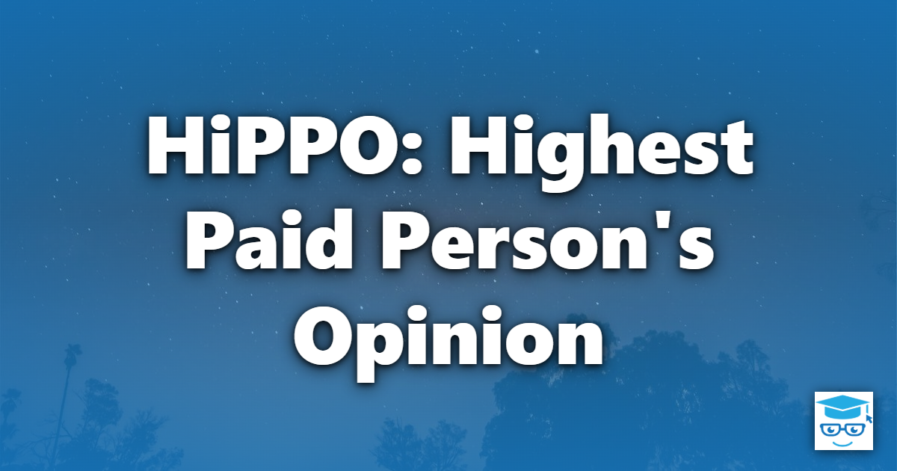

HiPPO stands for Highest Paid Person's Opinion. In this antipattern, decisions are made by whoever ranks highest in the room, rather than by data, experiments, or the people with the relevant expertise. Engineers' judgment and test results lose to a senior person's gut feeling, and over time people stop raising evidence that contradicts the boss.

The problem isn't that senior people have opinions, or that those opinions are wrong. Experience is valuable, and someone has to be accountable for the final call. The problem is when rank settles a question that evidence or expertise could have answered better.

## Origin of the Term

The term began at Intuit in 2006. According to [Ron Kohavi's account](https://exp-platform.com/hippo/), Dylan Lewis at Intuit came up with the acronym HiPO, for Highest Paid Opinion. Avinash Kaushik, who also worked at Intuit, mentioned it to Kohavi that August. Kohavi's team at Microsoft [adopted HiPPO instead](https://exp-platform.com/Documents/HiPPOOrigin.txt), since HiPO already meant High Potential there and HiPPO worked better with a picture of a hippo.

Kaushik [wrote about HiPPOs on his blog](https://www.kaushik.net/avinash/seven-steps-to-creating-a-data-driven-decision-making-culture/) that October. He is often credited with coining the term in his 2007 book, *Web Analytics: An Hour a Day*, though the term predates the book. Kohavi, Henne, and Sommerfield brought it to the experimentation community with their KDD 2007 paper, [*Practical Guide to Controlled Experiments on the Web: Listen to Your Customers not to the HiPPO*](https://exp-platform.com/practical-guide/). In *Trustworthy Online Controlled Experiments*, Kohavi, Tang, and Xu place personal opinion, "a.k.a. HiPPO", in the lowest tier of the hierarchy of evidence they present.

## Symptoms and Consequences

- The discussion ends as soon as the most senior person states a preference.
- Experiments are skipped, or their results are explained away when they disagree with the expected answer.
- Data is gathered to justify a decision that has already been made.
- Technical decisions are made by people far from the code, while the engineers who will build and run the system aren't asked or aren't heard.
- People learn to guess what the boss wants rather than work out what's true, so bad news and dissenting evidence stop being raised.
- Experts disengage, and some of the best of them leave for somewhere their judgment counts.
- The organization learns little from its decisions, since they were never framed as something that could be tested.

As Kaushik puts it, a HiPPO's "mere presence in a meeting prevents ideas from coming up." The damage is often invisible because no one can see the ideas that were never proposed. This makes HiPPO a close relative of [Mushroom Management](/antipatterns/mushroom-management/): one keeps information from reaching the team, while the other keeps it from reaching the decision. It also overlaps with [Not Invented Here](/antipatterns/not-invented-here/), since both dismiss ideas because of where they came from.

A related variant is what we might call Client Dictates the Implementation. A client or stakeholder who is paying for the work specifies how it should be built, rather than what problem it needs to solve, and the people with the relevant expertise build it that way without challenge.

## Solutions

- Let experiments and data settle the questions they can answer. If a question can be tested cheaply, such as with an A/B test, a prototype, or a benchmark, run the test rather than debating it.
- Have leaders speak last in design discussions. Once the most senior person has spoken, others tend to adjust their views to match, so collect everyone else's input first. Writing down opinions before the discussion starts can help, too.
- Separate the decision-maker from the subject-matter expert. Be explicit about who is accountable for a decision and who provides the expertise behind it, and expect the decision-maker to engage with that expertise, especially when overruling it.
- Agree on what would change your mind. Decide on success metrics before seeing the results, so the outcome can't be reinterpreted to fit the preferred answer.
- Reward people for raising inconvenient evidence. Team members need [courage](/values/courage/) to disagree with their boss, and that gets easier when leaders treat disagreement as useful [feedback](/values/feedback/).
- Give leaders better data rather than trying to route around them. Kohavi's team says it wants [those decision makers to have access to high quality data](https://exp-platform.com/hippo/). The aim is to inform them, not remove them from the decision.

## Don't Overcorrect

Not every decision can be settled with an experiment. Kohavi, Henne, and Sommerfield note that controlled experiments can show which variant is better and by how much, but not why. Long-term strategy, one-way decisions, and questions with no meaningful metric still rely on judgment, and that judgment may well belong to the most senior person in the room. Metrics can also mislead when they become targets, as [Goodhart's Law](/laws/goodharts-law/) warns.

Insisting on more data before any decision can be made leads to the opposite failure mode, [Analysis Paralysis](/antipatterns/analysis-paralysis/). The goal is to match the decision to the best evidence that's reasonably available, and to use senior judgment where evidence runs out, rather than in place of it.

## See Also

[Mushroom Management](/antipatterns/mushroom-management/)

[Not Invented Here](/antipatterns/not-invented-here/)

[Analysis Paralysis](/antipatterns/analysis-paralysis/)

[Respect](/values/respect/)

## References

[Ron Kohavi, Randal M. Henne, Dan Sommerfield - Practical Guide to Controlled Experiments on the Web: Listen to Your Customers not to the HiPPO (KDD 2007)](https://exp-platform.com/practical-guide/)

[Ron Kohavi, Diane Tang, Ya Xu - Trustworthy Online Controlled Experiments: A Practical Guide to A/B Testing (Cambridge University Press, 2020)](https://doi.org/10.1017/9781108653985)

[Experimentation Platform - HiPPO FAQ](https://exp-platform.com/hippo/)

[Avinash Kaushik - Seven Steps to Creating a Data Driven Decision Making Culture](https://www.kaushik.net/avinash/seven-steps-to-creating-a-data-driven-decision-making-culture/)

Avinash Kaushik - Web Analytics: An Hour a Day (2007)
