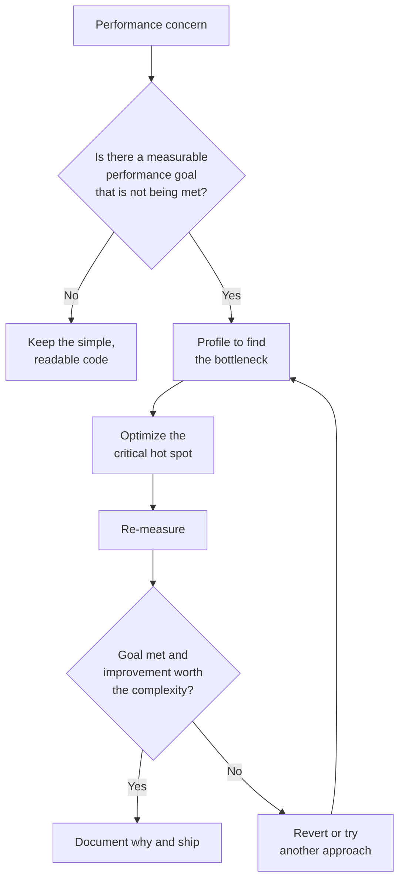

*Premature optimization is the root of all evil.* — Donald Knuth

Premature optimization is the act of spending effort, and usually adding complexity, to make code faster or smaller before you have evidence that performance is a problem. The optimization is "premature" because it happens before you know where the time or memory actually goes, and before you know whether anyone will notice the difference.

## Table of Contents

- [What Knuth Actually Said](#what-knuth-actually-said)
- [Why It Is an Antipattern](#why-it-is-an-antipattern)
- [Examples of Premature Optimization](#examples-of-premature-optimization)
- [A C# Example](#a-c-example)
- [Not an Excuse for Poor Design](#not-an-excuse-for-poor-design)
- [How to Optimize at the Right Time](#how-to-optimize-at-the-right-time)
- [Related Topics](#related-topics)
- [References](#references)

## What Knuth Actually Said

The phrase is almost always quoted as a single sentence, which strips out the meaning. It comes from Donald Knuth's 1974 paper "Structured Programming with go to Statements," where he wrote:

> Programmers waste enormous amounts of time thinking about, or worrying about, the speed of noncritical parts of their programs, and these attempts at efficiency actually have a strong negative impact when debugging and maintenance are considered. We *should* forget about small efficiencies, say about 97% of the time: premature optimization is the root of all evil. Yet we should not pass up our opportunities in that critical 3%.

Three points are worth noticing:

- **The target is noncritical code.** Knuth criticizes effort spent on parts of a program whose speed does not matter.
- **The cost is maintainability.** He says the damage shows up in debugging and maintenance, which is where [technical debt](/terms/technical-debt/) accumulates.
- **He endorses optimization of the critical 3%.** The quote is a call to focus, not a ban on performance work.

Knuth later attributed the saying to Tony Hoare, though its origin is debated. A related pair of rules comes from Michael A. Jackson's *Principles of Program Design* (1975): "The First Rule of Program Optimization: Don't do it. The Second Rule of Program Optimization (for experts only): Don't do it yet."

## Why It Is an Antipattern

Optimizing before you measure is a bet that you have guessed the bottleneck correctly. Developers guess wrong often, because modern runtimes, compilers, databases, caches, and networks behave in ways that are hard to predict from reading code. The bet has costs even when it loses:

- **Added complexity.** Hand-tuned code is usually harder to read than the straightforward version. Every reader, including the author six months later, pays that cost every time.
- **More defects.** Special cases, manual caching, and clever shortcuts create new places for bugs, such as stale data and off-by-one errors, to hide.
- **Wasted effort.** Time spent making a method that runs once per day 20% faster is time not spent on features, tests, or the real bottleneck.
- **Harder change.** Optimized code tends to bake in assumptions about data shape and usage. When requirements change, those assumptions get in the way.
- **False confidence.** A team that "already optimized" may stop looking for the real cause when the system is slow.

Premature optimization is closely related to [YAGNI](/principles/yagni/) (You Aren't Gonna Need It): it adds capability, in this case speed, that nobody has demonstrated a need for. It also works against [KISS](/principles/keep-it-simple/) (Keep It Simple, Stupid) because it trades simplicity for a benefit that may never materialize.

## Examples of Premature Optimization

The following scenarios are illustrative composites of mistakes teams commonly make, not documented incidents. Each starts with a reasonable-sounding instinct about performance.

### The Homegrown Cache

A team adds an in-memory cache around a database query "because the database is slow." No one measures the query. It turns out to take 3 ms against an indexed table. The cache now needs invalidation logic, and the first production incident is users seeing stale data after an update. A cache is a legitimate tool, but here it solved a problem nobody had and created one that was real.

### Micro-Optimizing the Wrong Layer

A developer replaces a readable `foreach` loop with manual index arithmetic and pooled buffers to save microseconds per call. Profiling later shows the request spends 800 ms waiting on a remote service and the loop accounts for well under 1% of the total. [Amdahl's Law](/laws/amdahls-law/) explains why: the overall speedup from improving one part is limited by how much of the total time that part represents.

### Denormalizing the Schema on Day One

To avoid "expensive joins," a schema is denormalized before the application has any data. Joins on indexed keys are cheap in a mature relational database. The duplicated columns, however, must be kept in sync forever, and every new feature has to account for them.

### Choosing Architecture for Imagined Scale

A system that will serve a few hundred internal users is built with sharding, message queues, and a distributed cache because it "needs to scale." The operational complexity slows development and makes failures harder to diagnose. This overlaps with [Big Design Up Front](/antipatterns/big-design-up-front/): it is a guess about the future locked in before the facts arrive.

### Obscure Code for Marginal Gains

Bit-twiddling tricks, hand-unrolled loops, and cryptic one-liners replace clear code for gains the compiler or JIT (just-in-time) compiler would have delivered anyway. The next maintainer has to reverse-engineer the trick, and a [readability](/practices/code-readability/) problem is born.

## A C# Example

The following code is "optimized" by hand to avoid allocating a list. It uses a manually managed array and a counter, and it is unclear and brittle.

```csharp
// Premature: hand-managed array to "avoid allocations."
// This runs once per HTTP request on a list of at most a few dozen items.
public static class PriceCalculator
{
    public static decimal[] GetDiscountedPrices(Product[] products, decimal discountRate)
    {
        var buffer = new decimal[products.Length];
        var count = 0;

        for (var i = 0; i < products.Length; i++)
        {
            if (!products[i].IsActive) continue;
            buffer[count++] = products[i].Price * (1 - discountRate);
        }

        // Trim to the actual size (an extra copy, which defeats the purpose).
        var result = new decimal[count];
        Array.Copy(buffer, result, count);
        return result;
    }
}

// Assumed for these samples: a Product with decimal Price and bool IsActive.
```

The straightforward version states its intent and is easy to change:

```csharp
// Clear first: optimize only if profiling shows this is a hot spot.
public static IReadOnlyList<decimal> GetDiscountedPrices(
    IEnumerable<Product> products, decimal discountRate) =>
    products
        .Where(p => p.IsActive)
        .Select(p => p.Price * (1 - discountRate))
        .ToList();
```

If a profiler later shows this method dominates allocation in a hot path, then it is time to reach for tools such as `ArrayPool<T>` or `Span<T>`, and to prove the improvement with a benchmark. [BenchmarkDotNet](https://benchmarkdotnet.org/) is the standard tool for .NET micro-benchmarks:

```csharp
[MemoryDiagnoser]
public class DiscountBenchmarks
{
    private readonly Product[] _products = Enumerable.Range(0, 50)
        .Select(i => new Product { Price = 10m + i, IsActive = i % 3 != 0 })
        .ToArray();

    [Benchmark(Baseline = true)]
    public decimal[] Linq() =>
        _products.Where(p => p.IsActive).Select(p => p.Price * 0.9m).ToArray();

    [Benchmark]
    public decimal[] Manual() => PriceCalculator.GetDiscountedPrices(_products, 0.1m);
}
```

A benchmark tells you whether the faster version is faster by an amount that matters. A profiler tells you whether the code is worth benchmarking at all.

## Not an Excuse for Poor Design

"Premature optimization is the root of all evil" is sometimes used to defend code that is slow by design. That reading ignores the second half of Knuth's quote. Avoiding premature optimization does not mean ignoring performance. Some decisions are cheap to get right the first time and expensive to fix later, and they are not optimizations at all. They are basic competence.

Treat these as design concerns, not premature optimizations:

- **N+1 queries.** Loading a list and then issuing one query per item is a design defect that is simple to avoid up front with a join or an eager load.
- **Wrong algorithmic complexity at a known scale.** If you know the collection holds a million items, an O(n²) nested loop is not a simplification, it is a bug waiting for production data. Choosing a dictionary over a list scan costs nothing.
- **Unbounded results.** Returning every row with no paging, when the table will grow, is a predictable failure.
- **Chatty remote calls.** Making many fine-grained network requests where one coarse request would do is an architectural choice, not a micro-optimization.
- **Missing indexes on obvious lookup columns.** Indexing the columns you filter and join on is routine schema design.

Avoid this N+1 pattern, a design defect that is known to be costly:

```csharp
var orders = await db.Orders.ToListAsync();
foreach (var order in orders)
{
    // One additional query per order.
    order.Customer = await db.Customers.FindAsync(order.CustomerId);
}
```

The straightforward, equally readable alternative loads everything in one query:

```csharp
var orders = await db.Orders.Include(o => o.Customer).ToListAsync();
```

The difference between the two categories is evidence and cost. If the better choice is just as simple and you have a clear reason to expect it matters, make it. If it adds complexity and you are guessing, wait.

## How to Optimize at the Right Time

Performance work is valuable when it is directed by data. A practical approach:

1. **Make it work, then make it clear.** Write correct, readable code first. Good tests and [refactoring](/practices/refactoring/) let you change the implementation later with confidence.
2. **Set a performance goal.** "Fast enough" needs a number, such as a 95th percentile response time or a throughput target. Without a goal you cannot know when to stop.
3. **Measure.** Use a profiler and production telemetry to find where time and memory go. See [Observability](/practices/observability/) for how to make that data available.
4. **Fix the biggest bottleneck first.** The critical 3% is rarely where you expect it to be.
5. **Prove the change.** Re-measure to confirm the optimization helped enough to justify its complexity. Revert it if it did not.
6. **Document the why.** When the code has to be less obvious for performance, leave a comment that names the measurement that justified it.



The diagram shows that optimization is the result of a failed measurement against a goal, not a starting point. If the goal is already met, the right action is to do nothing.

## Related Topics

- [YAGNI](/principles/yagni/) — Do not build for needs you have not demonstrated.
- [KISS](/principles/keep-it-simple/) — Prefer the simplest solution that works.
- [Simple Design](/practices/simple-design/) — Rules that favor clear, minimal code.
- [Big Design Up Front](/antipatterns/big-design-up-front/) — Another antipattern that commits to guesses before the facts are in.
- [Feature Creep](/antipatterns/feature-creep/) — Building more than is needed.
- [Technical Debt](/terms/technical-debt/) — The long-term cost of shortcuts, including "clever" ones.
- [Amdahl's Law](/laws/amdahls-law/) — Why improving a small part of the system limits overall gains.
- [Observability](/practices/observability/) — Gathering the data that makes measurement possible.

## References

- [Premature Optimization (C2 Wiki)](https://wiki.c2.com/?PrematureOptimization)
- Donald Knuth, "Structured Programming with go to Statements," *ACM Computing Surveys* 6(4), December 1974
- [BenchmarkDotNet](https://benchmarkdotnet.org/)
