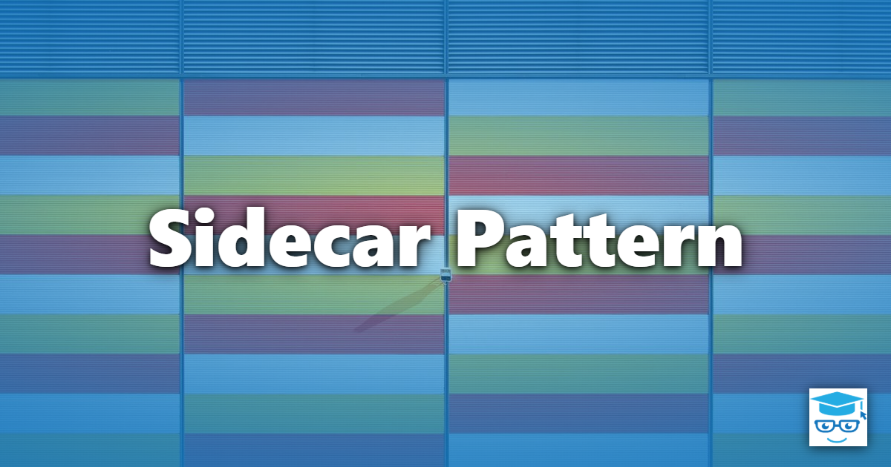
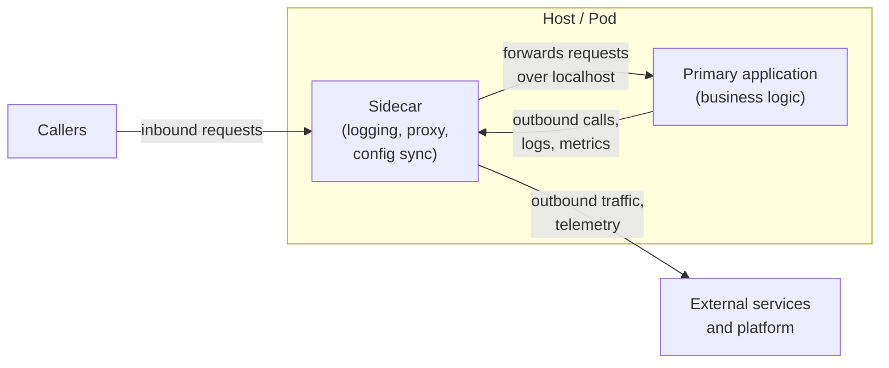

The Sidecar pattern deploys a helper component in a separate process or container next to the primary application. The two run on the same host (or in the same Kubernetes pod), start and stop together, and communicate over a local interface such as `localhost` or a shared volume. The helper handles a peripheral concern so the application does not have to.

The name comes from the motorcycle sidecar: a second compartment attached to the motorcycle that travels wherever the motorcycle goes and is retired along with it. Microsoft's description of the pattern uses the same analogy and also lists the alternate name *Sidekick pattern*.

## Where It Comes From

Sidecar is one of the cloud design patterns in the Azure Architecture Center catalog. It was described for containers in "Design Patterns for Container-based Distributed Systems" by Brendan Burns and David Oppenheimer (USENIX HotCloud 2016), which presents it as the first and most common of the patterns for multi-container deployments. In their words, sidecars "extend and enhance the main container." Their example is a web server paired with a log-saving sidecar that collects the server's logs from local disk and streams them to cluster storage.

## The Problem

Applications need monitoring, logging, configuration, networking, and security features that are not part of their core business logic. There are two obvious places to put them, and each has a cost:

- **In the application process.** The code runs efficiently and shares resources, but it must be written in the application's language, ships on the application's release schedule, and a fault in it can take down the application.
- **In a separate service.** The code is isolated and can use any technology, but every call crosses the network, and the service must be deployed, scaled, and operated on its own.

The Sidecar pattern sits between the two. The concern lives in its own process, which gives isolation and language independence, but the process is deployed with each application instance, which keeps it close and keeps its lifecycle tied to the application.

## How It Works

Each application instance gets its own sidecar instance. They share the host's network namespace (so they reach each other on `localhost`), and often a volume. The platform starts and stops them as a unit.



The application focuses on its core responsibility. The sidecar sits on the path between the application and the outside world (or beside it, reading logs and metrics) and provides the platform-facing behavior. Because the interface between them is a local protocol such as HTTP, gRPC, or files, the application can be written in any language.

## Typical Uses

These are common concerns that teams move into sidecars:

- **Observability and log shipping.** A sidecar tails log files, scrapes metrics, or receives traces and forwards them to a backend. The OpenTelemetry Collector documents running as an agent alongside the application, for example as a sidecar. See [Observability](/practices/observability/).
- **Service mesh proxies.** Meshes such as Istio (Envoy) and Linkerd inject a proxy sidecar into each pod. The proxy handles mutual TLS (mTLS), retries, traffic routing, and request-level telemetry without application changes.
- **TLS termination and certificate handling.** A proxy sidecar accepts encrypted connections and forwards plain traffic to the application over `localhost`, or manages client certificates for outbound calls.
- **Configuration and secrets sync.** A sidecar pulls configuration or secrets from a central store, writes them to a shared volume, and refreshes them when they change. Burns and Oppenheimer's second example is a sidecar that keeps content from a git repository synchronized for a web server to serve.
- **Dependency abstraction.** The Distributed Application Runtime (Dapr) runs a sidecar process (`daprd`) that exposes building blocks for state, pub/sub, and service invocation over local HTTP or gRPC. The application codes against that API rather than a vendor SDK for each backing service.

### Polyglot Benefit

A library must be written, tested, and maintained once per language. A sidecar is written once and used by every application regardless of language. A platform team can ship a single mTLS or telemetry sidecar to services written in C#, Go, Java, and Node.js, and update it without asking each team to upgrade a dependency. The same property lets you add capabilities to an application that cannot be changed, such as a legacy or third-party binary.

## Example: Kubernetes Pod

In Kubernetes, a pod is the natural host for a sidecar: its containers share a network namespace and can share volumes. Since Kubernetes v1.33, *sidecar containers* are a stable feature. You declare one as an init container with `restartPolicy: Always`:

```yaml
apiVersion: v1
kind: Pod
metadata:
  name: orders-api
spec:
  initContainers:
    # restartPolicy: Always makes this init container a sidecar. The kubelet
    # starts it before the app container and keeps it running for the pod's life.
    - name: log-shipper
      image: registry.example.com/log-shipper:1.0.0
      restartPolicy: Always
      volumeMounts:
        - name: logs
          mountPath: /var/log/orders
  containers:
    - name: orders-api
      image: registry.example.com/orders-api:1.0.0
      ports:
        - containerPort: 8080
      volumeMounts:
        - name: logs
          mountPath: /var/log/orders
  volumes:
    - name: logs
      emptyDir: {}
```

The application writes log files to the shared `emptyDir` volume. The sidecar reads them and ships them to the logging backend. The application has no knowledge of where the logs end up.

Native sidecar containers address a long-standing weakness of the pattern. Before this feature, a sidecar was just another entry in `containers`, so Kubernetes made no guarantee about which container started first or finished last. A proxy sidecar that was not yet ready could cause the application's first outbound calls to fail, and one that exited first could cut off the application's final requests during shutdown. With a native sidecar, the kubelet starts the sidecar and waits for it to report started before starting the next container, and on termination it waits for the main application container to stop before shutting the sidecar down. If the sidecar defines a `readinessProbe`, its result contributes to the pod's readiness. Native sidecars first appeared in v1.28 and graduated to stable in v1.33; on older clusters, check the feature gate and your platform's guidance.

## Example: An Application That Stays Unaware

The point of the pattern is that application code remains unaware of the concern the sidecar handles. This ASP.NET Core minimal API saves and loads order state through a Dapr sidecar. The application contains no Redis, Cosmos DB, or SQL client; which state store backs `orderstate` is configured in a Dapr component definition, outside the application. The Dapr component definition and the sidecar attachment (`dapr run` locally, or pod annotations on Kubernetes) are omitted for brevity. In real code, the Dapr .NET SDK's `DaprClient` (the `Dapr.Client` namespace) is the usual choice for calling the sidecar; this example uses raw HTTP to make the sidecar boundary visible.

```csharp
using System.Net;

var builder = WebApplication.CreateBuilder(args);

// Dapr sets DAPR_HTTP_PORT in the application's environment. The sidecar is
// on localhost; only the port varies. 3500 is just a fallback for local runs.
var daprPort = Environment.GetEnvironmentVariable("DAPR_HTTP_PORT") ?? "3500";

builder.Services.AddHttpClient("sidecar", client =>
{
    client.BaseAddress = new Uri($"http://localhost:{daprPort}/v1.0/");
});

var app = builder.Build();

const string StateStore = "orderstate";

app.MapPut("/orders/{id}", async (
    string id, Order order, IHttpClientFactory httpClientFactory) =>
{
    var client = httpClientFactory.CreateClient("sidecar");

    // The Dapr state API takes a JSON array of key/value objects.
    var response = await client.PostAsJsonAsync(
        $"state/{StateStore}",
        new[] { new { key = id, value = order } });

    response.EnsureSuccessStatusCode(); // Dapr returns 204 on success
    return Results.NoContent();
});

app.MapGet("/orders/{id}", async (string id, IHttpClientFactory httpClientFactory) =>
{
    var client = httpClientFactory.CreateClient("sidecar");
    // id is caller-supplied; escape it so it cannot change the URL's shape (for example with ? or #).
    var response = await client.GetAsync($"state/{StateStore}/{Uri.EscapeDataString(id)}");

    // Dapr returns 204 with an empty body when the key does not exist.
    if (response.StatusCode == HttpStatusCode.NoContent)
    {
        return Results.NotFound();
    }

    response.EnsureSuccessStatusCode();
    var order = await response.Content.ReadFromJsonAsync<Order>();
    return Results.Ok(order);
});

app.Run();

public record Order(string CustomerId, decimal Total);
```

Swapping the backing store from Redis to PostgreSQL means editing a component file and redeploying the sidecar configuration; this code does not change. The cost is visible in the example too: every state operation is now an extra local HTTP call, and the application is coupled to the sidecar's API instead of a vendor's.

Dapr is one illustration. A service mesh proxy takes the idea further, because the application does not call the sidecar explicitly at all. The platform redirects the application's ordinary network traffic through the proxy.

## Tradeoffs

The pattern buys isolation and reuse and pays for them in runtime and operational cost. These are the tradeoffs to weigh:

- **Per-instance resource overhead.** Every application instance carries its own sidecar, so the CPU and memory of the sidecar is multiplied by the replica count. Istio's documentation describes this as a resource cost and operational overhead of sidecar mode, which is why it also offers an "ambient" mode without per-pod proxies. For a small application the sidecar can cost more than the application.
- **Added latency.** Traffic through a proxy sidecar takes extra hops (application to sidecar, sidecar to destination). The hops are local and short, but they add up on chatty or latency-critical paths.
- **Startup and shutdown ordering.** If the application depends on the sidecar being ready, or the sidecar must outlive the application to flush data, the platform must enforce that. Kubernetes native sidecar containers provide this guarantee; elsewhere you write the ordering logic yourself.
- **Operational and versioning complexity.** The sidecar is a second thing to build, deploy, monitor, secure, and upgrade for every service. Rolling out a new sidecar version means restarting application pods, and a bug in it affects every application that uses it. Version skew between the application and its sidecar becomes a compatibility surface.
- **Failure modes.** The sidecar is a new place for failures to occur. A crashed or misconfigured proxy can make a healthy application unreachable, and debugging spans two processes.
- **Security cuts both ways.** A sidecar often holds credentials such as mesh certificates or secrets, and it shares the pod with the application, so a compromised application can reach them. On the other hand, Microsoft's description notes that encapsulating these tasks in separate processes reduces the attack surface to only the necessary code, and that sidecars can add cross-cutting security controls to components that lack native support for them.

### Sidecar vs. In-Process Library

A library is often the simpler answer. The two options differ along these lines:

| Concern | Sidecar | In-process library |
| --- | --- | --- |
| Language support | One implementation serves every language | One implementation per language |
| Isolation | Separate process; a crash or leak is contained | Shares the application's process and memory |
| Upgrades | Replace the sidecar independently, but restart the pod | Update the dependency and redeploy the app |
| Call cost | Interprocess call on every use | In-process call |
| Resource cost | Extra process per instance | Shares the application's resources |
| Integration depth | Limited to what the local interface exposes | Full access to application types and context |
| Operations | Another component to deploy and monitor | No extra components |

Choose a sidecar when many applications in different languages need the same capability, when a platform team owns the concern, when you cannot modify the application, or when the concern must be isolated from the application's runtime. Choose a library when everything is written in one language, the integration needs access to application internals, or latency and resource budgets are tight.

### When Not to Use It

Avoid the Sidecar pattern when:

- The application is small, or the number of instances is small, so the overhead outweighs the benefit.
- The path is latency-critical or the components talk to each other very frequently.
- The component needs to scale independently of the application. A sidecar scales one-to-one with its host, so a component with different scaling needs should be its own service.
- The platform already provides the capability natively, or a sidecar-less option (such as a mesh in ambient mode) meets the requirement.
- The functionality needs deep integration with application code, so a library is the better fit.

## Relationship to Other Patterns

Burns and Oppenheimer describe two other single-node patterns that use the same co-located container structure as the sidecar and differ in intent:

- **Ambassador.** An ambassador proxies communication to and from the main container, presenting the application with a simplified view of the outside world. Their example is an application that believes it is talking to a single memcache on `localhost` while the ambassador shards the requests across a cluster. Microsoft's documentation notes that an ambassador can be deployed as a sidecar. Service mesh proxies are the widespread example.
- **Adapter.** An adapter does the reverse: it presents the outside world with a standardized view of the application, for example by exposing a uniform metrics or monitoring interface for applications that each report differently.

A sidecar is the general case (extend the main container), while the ambassador and adapter are specializations of it that focus on outbound communication and on standardizing an interface, respectively.

Sidecars also relate to several DevIQ topics:

- **[Proxy Pattern](/design-patterns/proxy-pattern/).** A proxy sidecar applies the Proxy pattern at the process level: it stands in for the remote service and controls access to it, but runs as a separate process rather than an in-process object.
- **[Decorator Pattern](/design-patterns/decorator-pattern/).** A sidecar wraps an application with added behavior without modifying it, which is the intent of a decorator. The difference is the boundary: a decorator wraps an object in the same process, while a sidecar wraps a process.
- **[Adapter Pattern](/design-patterns/adapter-design-pattern/).** The adapter sidecar applies the same idea of translating one interface into another, at the deployment level.
- **[Separation of Concerns](/principles/separation-of-concerns/).** A sidecar is a deployment-level way to separate cross-cutting infrastructure concerns from business logic.
- **[Distributed Monolith](/architecture/distributed-monolith/).** Moving a concern into a sidecar does not decouple services from each other. If every service must be upgraded in lockstep with a shared sidecar, the sidecar becomes one more coupling point in a system that already suffers from tight coupling.

## When to Use

The Sidecar pattern is a strong fit when:

- Several applications, possibly in different languages, need the same infrastructure capability.
- A platform or operations team owns the concern and needs to update it independently of application releases.
- You need to add behavior to an application you cannot or should not change.
- The capability should be isolated from the application's process for fault containment or resource limits.

It is probably not the right choice for small systems, latency-critical paths, or single-language codebases where a library does the job with less machinery.

## References

- [Sidecar Pattern (Microsoft Azure Architecture Center)](https://learn.microsoft.com/en-us/azure/architecture/patterns/sidecar)
- [Ambassador Pattern (Microsoft Azure Architecture Center)](https://learn.microsoft.com/en-us/azure/architecture/patterns/ambassador)
- [Design Patterns for Container-based Distributed Systems (Burns and Oppenheimer, USENIX HotCloud 2016)](https://www.usenix.org/conference/hotcloud16/workshop-program/presentation/burns)
- [Sidecar Containers (Kubernetes documentation)](https://kubernetes.io/docs/concepts/workloads/pods/sidecar-containers/)
- [Dapr Sidecar Architecture (Dapr documentation)](https://docs.dapr.io/concepts/dapr-services/sidecar/)
- [State Management API (Dapr documentation)](https://docs.dapr.io/reference/api/state_api/)
- [Istio Data Plane Modes (Istio documentation)](https://istio.io/latest/docs/overview/dataplane-modes/)
- [Linkerd Architecture (Linkerd documentation)](https://linkerd.io/docs/reference/architecture/)
- [Collector Agent Deployment Pattern (OpenTelemetry documentation)](https://opentelemetry.io/docs/collector/deploy/agent/)
