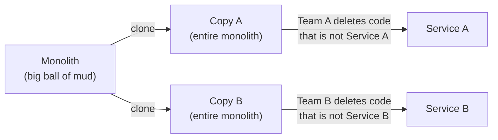

Tactical forking is a technique for breaking a monolithic application into smaller, separately deployed services. Rather than carefully extracting the code for each service out of the monolith, you copy the *entire* monolith once for each target service and then delete everything that service does not need. What remains is the new service.

The technique is described in *Software Architecture: The Hard Parts* by Neal Ford, Mark Richards, Pramod Sadalage, and Zhamak Dehghani (O'Reilly, 2021). The authors credit the pattern to Fausto De La Torre, and summarize the reasoning behind it as being that deleting code is easier than extracting it.

## The Problem

The usual approach to decomposing a monolith is *component-based decomposition*: identify the components in the codebase, tidy up their dependencies and shared code, and then lift them into services one at a time. This works well when the monolith has a recognizable internal structure, such as a [Modular Monolith](/architecture/modular-monolith/) or a cleanly [layered](/architecture/layered-architecture/) application whose components have clear boundaries.

Many legacy systems do not have that structure. A [Big Ball of Mud](/antipatterns/big-ball-of-mud/) has no meaningful boundaries. Classes call into each other freely, "utility" code is shared everywhere, and the domain is tangled through every layer. Trying to extract a single service from this kind of codebase means following a web of dependencies and untangling each strand by hand before anything can move. The analysis alone can take months, and during that time no team delivers a single service.

Tactical forking sidesteps the untangling. It trades a clean extraction for a fast, mechanical start and defers cleanup until after the services exist.

## How It Works

The process starts with a single monolith and a set of target services, each owned by a team. It has three phases:

1. **Clone.** Copy the whole monolith, one copy per target service. Each team receives a complete, working copy of the codebase.
2. **Delete.** Each team removes all the code that does not belong to its service. The team keeps the code for its own domain functionality and deletes the rest, using the compiler, tests, and the running application to find out what is still needed.
3. **Harden.** Once the unneeded code is gone, each team cleans up what remains: removing vestigial code, renaming and reorganizing, and resolving shared data and shared code, so that each fork becomes a proper service.

The diagram shows two target services. Both teams begin with identical codebases and work in parallel, each deleting in a different direction. Neither team needs to modify the original monolith, which can continue to run until the new services replace it.

### Deleting Instead of Extracting

Extraction asks, "What does this service depend on, and how do I move it?" Every answer requires understanding code outside the service's domain. Deletion asks a simpler question: "Is this part of my service?" If not, it goes. The compiler and the test suite report mistakes quickly, because a deleted dependency that was still needed produces a build error or a failing test.

A team can delete in whichever order is convenient. Typical moves include removing entire modules or packages for other domains, removing the UI screens and endpoints the service will not expose, and dropping tests that only cover deleted code.

## When to Use It

Consider tactical forking when:

- The monolith has little or no internal structure, so component-based decomposition is impractical.
- Several teams are available and each could own part of the system.
- The business wants teams to make visible progress soon, rather than waiting for a long analysis phase.
- The existing code is in poor enough shape that most of it needs rework anyway.

Prefer component-based decomposition when the code is already organized into components with defined boundaries. Extracting well-defined components preserves a single copy of the code and avoids the duplication that forking creates.

## Benefits

These are some of the benefits of tactical forking:

- **Teams start right away.** Each team has a complete, running codebase on the first day and does not wait on up-front dependency analysis.
- **Deleting is easier than untangling.** Removing code that does not belong requires less understanding of the whole system than moving code with all its dependencies intact.
- **Less up-front analysis.** The team discovers what the service needs by removing things and seeing what breaks, rather than by mapping the entire dependency graph first.
- **Parallel work.** Teams work on separate copies and rarely block one another during the delete phase.
- **Low risk to the original.** The monolith keeps running, unchanged, while the forks are carved down.

## Tradeoffs

Tactical forking moves cleanup work later rather than removing it. These are some of the tradeoffs:

- **Duplicated code.** Code that more than one service needs ends up in several forks. Each copy can then evolve separately, so bug fixes and changes must be applied more than once, or the copies drift apart. Shared functionality needs a deliberate decision later: a shared library, a dedicated service, or accepted duplication.
- **Leftover and dead code.** Deletion is only as good as the team's ability to recognize what is unused. Dead code that nothing references, but that no test or compiler complains about, tends to survive.
- **Vestigial naming and structure.** Namespaces, package names, configuration keys, and project names still describe the original monolith. A service named for one domain may carry the monolith's name throughout.
- **The shared database remains a problem.** Cloning the code does not split the data. Each fork still points at the monolith's database schema, so teams must separate the tables, assign data ownership, and deal with cross-service queries and joins. This is often the hardest part of decomposition.
- **Risk of a distributed monolith.** If the forks are not truly separated, they continue to share the database, shared libraries, or tightly coupled call patterns. The result is many deployed services that must still change and release together, which is a [Distributed Monolith](/architecture/distributed-monolith/).
- **Poor code stays poor.** Forking does not improve code quality. A well-delimited service built from a bad codebase is still a bad codebase unless the team invests in the hardening phase.

> **Note:** Treat the harden phase as part of the work, not optional follow-up. Without it, the organization pays for the operational complexity of services but receives little of the benefit.

## Comparison with Other Approaches

### Component-Based Decomposition

Component-based decomposition identifies components within the monolith, cleans up their dependencies, groups them into domains, and then extracts each domain as a service. It keeps one copy of each piece of code and produces cleaner results, but it requires a monolith that is structured enough to analyze. Tactical forking is the alternative when that structure is missing and the cost of analysis is too high.

### Strangler Fig

The [Strangler Fig pattern](/design-patterns/strangler-fig-pattern/) migrates functionality gradually by routing requests through a facade and replacing features one at a time with new implementations, often written from scratch. The legacy system shrinks as new code takes over.

The two differ in how new services come into being:

| Concern | Tactical forking | Strangler Fig |
| --- | --- | --- |
| Starting point for a new service | A copy of the whole monolith | New code (or rewritten code) |
| How the service takes shape | Delete what is not needed | Build up what is needed |
| Traffic switching | Needed when the forks replace the monolith | Core mechanism, via a routing facade |
| Code reuse | High initially, with duplication | Low; behavior is reimplemented |
| Main risk | Leftover cruft and duplication | Long migration and parallel systems |

The patterns can be combined. A team might fork the monolith to get a service started, then use a strangler facade to move traffic from the monolith to the new service incrementally.

## Example Scenario

An online retailer runs a single order management application. Orders, inventory, customer accounts, and invoicing are intermingled in one large codebase, and nobody can say with confidence which classes depend on which. Leadership wants separate Orders and Inventory services, owned by separate teams.

With tactical forking, the Orders team and the Inventory team each clone the repository. The Orders team deletes the inventory-management screens and endpoints, inventory background jobs, and the tests for them, and then fixes the compile errors that remain. The Inventory team does the same in the other direction. Both teams find a few places where the two domains call into each other. Those calls become explicit integration points, such as an API call or an event, and are recorded for the harden phase.

After deleting, each team renames the projects, removes configuration it no longer uses, and moves its tables into a schema it owns. Both services still contain a copy of a pricing helper that was written in the original monolith. The teams decide whether to share it as a library or keep a copy in each.

## Guidance

These practices help a tactical forking effort succeed:

- Agree on service boundaries and ownership before cloning, even if the boundaries are approximate.
- Commit to a time-boxed delete phase and a defined harden phase, with explicit exit criteria for each service.
- Rely on automated tests, builds, and static analysis to find dead code and unresolved dependencies.
- Keep a list of duplicated functionality discovered during deletion, and decide on an owner for each.
- Plan the database separation early. Do not let the forks continue to share a schema indefinitely.
- Rename early. Update namespaces, project names, and configuration as soon as a fork stabilizes, before vestigial names spread.

## References

- Neal Ford, Mark Richards, Pramod Sadalage, and Zhamak Dehghani. [*Software Architecture: The Hard Parts: Modern Trade-Off Analyses for Distributed Architectures*](https://www.oreilly.com/library/view/software-architecture-the/9781492086888/). O'Reilly Media, 2021.
- [Distributed Monolith](/architecture/distributed-monolith/)
- [Modular Monolith](/architecture/modular-monolith/)
- [Big Ball of Mud](/antipatterns/big-ball-of-mud/)
- [Strangler Fig Pattern](/design-patterns/strangler-fig-pattern/)
