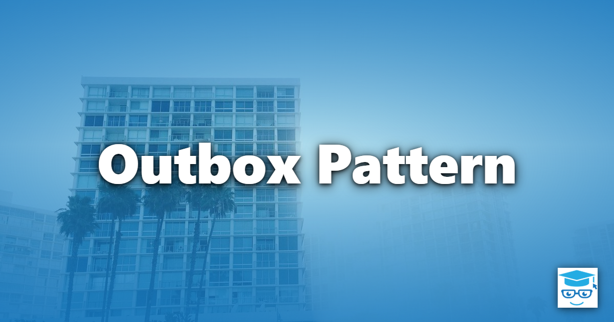
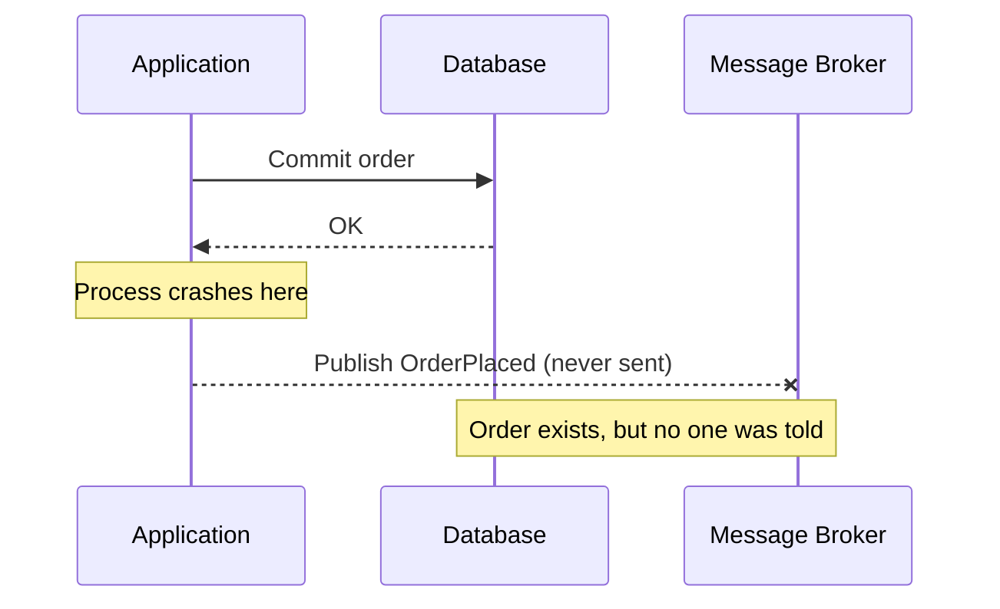
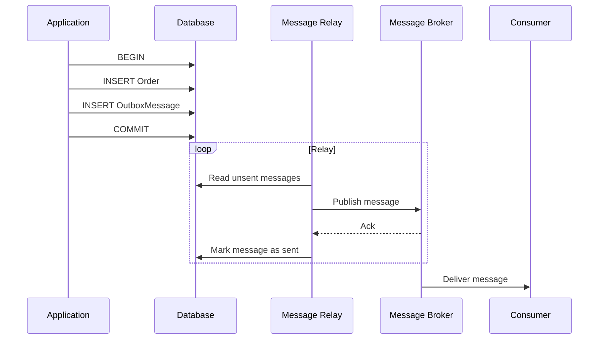

> **Looking for something else?** This article is about a *software design pattern* for reliable
> messaging between a database and an external system. It is **not** about an email outbox, the
> Outbox folder in a mail client such as Outlook, a service that sends outbound email, or a
> product named Outbox. If one of those is what you were searching for, this isn't the page
> you're after. [OutboxServer](https://outboxserver.com/), for example, *is* about sending email:
> it's an organization-wide email-sending microservice, typically deployed as a Docker container.
> If you are building a system that sends email, see
> [the connection to email](#the-connection-to-email) below.

The Outbox pattern (also called the Transactional Outbox) makes it safe to change your own
database *and* tell an external system about it, without a distributed transaction. Instead of
sending the message directly, the application saves it to an "outbox" table in the same local
transaction as the business data. A separate process later reads the outbox and delivers the
messages. The local transaction guarantees that either both the data change and the pending
message are saved, or neither is.

## The Problem: Dual Writes

Many business operations must do two things: update the application's own database and have an
effect on something outside it. That external dependency might be a message broker, a third-party
API, a search index, or an email service. Writing to two independent systems like this is called a
*dual write*, and it can't be made atomic with an ordinary database transaction.

A distributed transaction (such as two-phase commit, 2PC) can span both resources, but it is
often unavailable (most message brokers and HTTP APIs don't participate), or undesirable because
it couples availability and adds latency and locking.

Without one, a naive implementation has two failure modes, depending on the order of the calls:

```csharp
// Naive approach 1: commit, then publish
await _db.SaveChangesAsync();                 // order saved
await _bus.PublishAsync(new OrderPlaced(id)); // process crashes or broker is down: message lost

// Naive approach 2: publish, then commit
await _bus.PublishAsync(new OrderPlaced(id)); // message sent
await _db.SaveChangesAsync();                 // fails or rolls back: message describes a lie
```

- **Commit then publish:** if the process crashes, or the broker is unavailable, after the commit
  but before the publish, the order exists but nobody is ever told. Downstream systems never
  learn about it.
- **Publish then commit:** if the transaction rolls back after the message is sent, consumers act
  on an event for something that never happened.

Retrying doesn't fully solve either problem, because the process that would retry may be the one
that just crashed.



## How the Outbox Pattern Works

The pattern replaces the second write to the external system with a second write to the *same*
database. A relational database can commit two rows atomically, so the problem goes away.

1. **Write atomically.** In one local transaction, save the business data and insert a row into an
   `Outbox` (or `OutboxMessages`) table describing the message to send.
2. **Relay.** A separate component, the *message relay*, reads unsent outbox rows and delivers them
   to the external system.
3. **Mark as sent.** After the external system acknowledges the message, the relay marks the row
   as processed, or deletes it.



The application's request completes as soon as the local transaction commits. Delivery is
asynchronous, so the external system is updated *eventually*, even if the broker was down at the
moment the order was placed.

### Writing to the Outbox

The key idea is that the outbox row and the business data are saved by the same `SaveChanges`
call, which EF Core wraps in a single database transaction. This example uses EF Core and a
simple `OutboxMessage` entity:

```csharp
public class OutboxMessage
{
    public Guid Id { get; init; } = Guid.NewGuid();     // doubles as the message id
    public required string Type { get; init; }          // e.g. "OrderPlaced"
    public required string Payload { get; init; }       // serialized message body
    public DateTime OccurredOnUtc { get; init; } = DateTime.UtcNow;
    public DateTime? ProcessedOnUtc { get; set; }       // null until delivered
}

// AppDbContext is your EF Core DbContext (illustrative).
public class PlaceOrderHandler(AppDbContext db)
{
    public async Task HandleAsync(PlaceOrderCommand command, CancellationToken ct)
    {
        // Order.Id is assigned client-side (a Guid), so it's available before the save.
        // A database-generated key would not be set yet when the payload is serialized.
        var order = new Order(command.CustomerId, command.Items);
        db.Orders.Add(order);

        db.OutboxMessages.Add(new OutboxMessage
        {
            Type = nameof(OrderPlaced),
            Payload = JsonSerializer.Serialize(new OrderPlaced(order.Id, order.CustomerId))
        });

        // One SaveChanges = one transaction: the order and its outbox message
        // are committed together, or neither is.
        await db.SaveChangesAsync(ct);
    }
}
```

Nothing in this handler talks to the broker. If the transaction commits, the message is
durably recorded and will be picked up by the relay. If it rolls back, there is no message.

### The Message Relay

Something has to move rows from the outbox to the external system. Two approaches are common.

- **Polling publisher.** A background process queries the outbox table at an interval, publishes
  any unprocessed messages, and marks them as processed. It is simple and works with any
  database, but it adds polling load and latency (up to one polling interval).
- **Transaction log tailing.** A change data capture (CDC) tool, such as
  [Debezium](https://debezium.io/), reads the database's transaction log and publishes each
  inserted outbox row. It has lower latency and puts no polling query load on the database, but it
  depends on database-specific log access and adds operational infrastructure.

A polling publisher built on a .NET `BackgroundService` looks like this:

```csharp
// IMessagePublisher is your broker abstraction (illustrative).
public class OutboxRelay(IServiceScopeFactory scopes, ILogger<OutboxRelay> logger)
    : BackgroundService
{
    protected override async Task ExecuteAsync(CancellationToken stoppingToken)
    {
        using var timer = new PeriodicTimer(TimeSpan.FromSeconds(5));
        while (await timer.WaitForNextTickAsync(stoppingToken))
        {
            using var scope = scopes.CreateScope();
            var db = scope.ServiceProvider.GetRequiredService<AppDbContext>();
            var bus = scope.ServiceProvider.GetRequiredService<IMessagePublisher>();

            var pending = await db.OutboxMessages
                .Where(m => m.ProcessedOnUtc == null)
                .OrderBy(m => m.OccurredOnUtc)
                .Take(100)
                .ToListAsync(stoppingToken);

            foreach (var message in pending)
            {
                try
                {
                    // Pass the outbox Id along so consumers can detect duplicates.
                    await bus.PublishAsync(
                        message.Id, message.Type, message.Payload, stoppingToken);
                    message.ProcessedOnUtc = DateTime.UtcNow;
                    await db.SaveChangesAsync(stoppingToken);
                }
                catch (Exception ex) when (ex is not OperationCanceledException)
                {
                    logger.LogWarning(
                        ex, "Failed to publish or mark outbox message {Id} as sent; will retry",
                        message.Id);
                    break; // stop this batch; retry on the next tick
                }
            }
        }
    }
}
```

This sketch assumes a single relay instance. Running several instances needs a way to claim rows
(for example, `SELECT ... FOR UPDATE SKIP LOCKED` in databases that support it), or they publish
the same messages more than once.

## Delivery Guarantees: At-Least-Once

The relay can crash after publishing a message but before marking it as sent. On restart it
publishes the message again. The outbox therefore provides **at-least-once** delivery: no message
is lost, but a message may be delivered more than once.

Consumers must be **idempotent**, meaning that processing the same message twice has the same
effect as processing it once. Common techniques include:

- Using naturally idempotent operations (set a status to `Shipped` rather than increment a
  counter).
- Recording the IDs of processed messages and skipping repeats. The outbox row's `Id` is a good
  deduplication key. This is the **Inbox pattern**, the consumer-side counterpart to the outbox:
  the consumer writes the message ID to an `Inbox` table in the same local transaction as its
  own business changes.
- Passing an idempotency key to a third-party API that supports one.

## Ordering

Ordering is only as strong as you build it. A single relay that reads rows in a stable order and
publishes them sequentially preserves that order per outbox. Be aware of these caveats:

- Auto-increment IDs and timestamps don't always reflect commit order, because they're assigned
  before commit and concurrent transactions can commit in a different order than they started. A
  row with a lower ID can become visible after a row with a higher one.
- The sample orders by `OccurredOnUtc`, which is set when the message is created, so its order is
  approximate. Log tailing (CDC) comes closest to true commit order.
- Multiple relay instances, batching, and retries can reorder messages.
- Brokers usually guarantee order only within a partition or session, so choose a partition key
  (such as the aggregate ID) that keeps related messages together.
- A failed message that is skipped while later ones are sent breaks ordering. The sample above
  stops the batch instead.

If strict global order matters, the pattern gets harder. Design consumers to tolerate out-of-order
messages where you can, for example by including a version or sequence number per aggregate.

## Operating an Outbox

A working outbox needs some housekeeping.

### Cleanup and Retention

Left alone, the outbox table grows without bound, and a large table slows the relay's query. Delete
(or archive) processed rows after a retention period, with a scheduled job that deletes in small
batches. Keep processed rows long enough to help with debugging and to replay messages if a
downstream system loses data. An index on the unprocessed rows (for example, a filtered index on
`ProcessedOnUtc IS NULL`) keeps polling cheap.

### Retries and Poison Messages

A message that can never be delivered, such as one that is malformed or that the receiver rejects
permanently, is a *poison message*. If the relay retries it forever and processes strictly in
order, it blocks everything behind it. Count delivery attempts, use exponential backoff between
retries, and after a maximum number of attempts move the message to a dead-letter table or queue
and raise an alert for a human to review. Distinguish transient failures (broker unavailable,
which should retry) from permanent ones (invalid payload, which should not).

### Monitoring

Track the age of the oldest unprocessed message and the number of pending messages. A growing
backlog means the relay is stuck, slow, or down.

## The Connection to Email

Sending an email is a typical external side effect: "when the order is placed, send a confirmation"
is a dual write like any other. If the order commit succeeds but the process dies before the email
is sent, the customer never gets the confirmation. You can use the Outbox pattern to make that
reliable. The outbox row says "send this email", and the relay hands it to an email provider. But
the pattern is about *any* reliable side effect. Email is just one example, alongside publishing
integration events, calling a payment gateway, or updating a search index.

## When to Use It

- You must update your own database **and** notify or call something external, and losing the
  notification (or sending one for a rolled-back change) is unacceptable.
- The external system can't take part in your database transaction, and a distributed transaction
  isn't an option.
- You are publishing [domain events](/design-patterns/domain-events-pattern/) as integration
  events to other services in an
  [event-driven architecture](/architecture/event-driven-architecture/).
- You can accept eventual consistency and at-least-once delivery.

## When Not to Use It

- **Nothing external is involved.** If everything lives in one database, use a local transaction
  (or the [Unit of Work](/design-patterns/unit-of-work-pattern/) pattern).
- **Losing a message is acceptable,** such as best-effort telemetry or cache invalidation.
- **The caller needs a synchronous answer.** The outbox is asynchronous, so it doesn't suit
  calls where the user must see the external system's response before the request completes.
- **Consumers can't be made idempotent** and duplicates are harmful. Fix that first.
- **The extra moving parts aren't worth it.** The outbox table, relay, cleanup, and monitoring
  are real operational cost. For a small system with a single, low-stakes integration, simpler
  options may be enough.
- **The broker and database can share a transaction,** or the database offers a native feature for
  this. Check what your platform already provides.

## Relationship to Other Patterns

- [Domain Events](/design-patterns/domain-events-pattern/): post-persistence domain events can be
  turned into outbox rows, so that integration events are published only for committed changes.
- [Unit of Work](/design-patterns/unit-of-work-pattern/): the Unit of Work provides the single
  transaction in which the business data and the outbox row are saved together.
- [Competing Consumers](/architecture/competing-consumers/): consumers pulling from the queue the
  relay publishes to must handle duplicate deliveries.
- [Event-Driven Architecture](/architecture/event-driven-architecture/): the outbox is a common
  way to publish events reliably from a service.
- [CQRS](/design-patterns/cqrs-pattern/): events that update read models are often published
  through an outbox.

## Libraries That Provide an Outbox

You don't have to build all of this yourself. These .NET messaging frameworks document built-in
outbox support:

- [MassTransit](https://masstransit.massient.com/configuration/middleware/outbox) offers a
  transactional outbox (with Entity Framework Core and other persistence options).
- [NServiceBus](https://docs.particular.net/nservicebus/outbox/) includes an Outbox feature that
  deduplicates incoming messages and stores outgoing ones in the same transaction as business data.
- [Wolverine](https://wolverinefx.net/guide/durability/) provides durable inbox and outbox
  messaging.

Check each library's documentation for current configuration details and supported databases.

## References

- [Pattern: Transactional outbox (microservices.io, Chris Richardson)](https://microservices.io/patterns/data/transactional-outbox.html)
- [Pattern: Polling publisher](https://microservices.io/patterns/data/polling-publisher.html)
- [Pattern: Transaction log tailing](https://microservices.io/patterns/data/transaction-log-tailing.html)
- [Pattern: Idempotent consumer](https://microservices.io/patterns/communication-style/idempotent-consumer.html)
- [Implement the Transactional Outbox pattern by using Azure Cosmos DB (Microsoft Learn)](https://learn.microsoft.com/en-us/azure/architecture/databases/guide/transactional-out-box-cosmos)
- [Debezium Outbox Event Router](https://debezium.io/documentation/reference/transformations/outbox-event-router.html)
- [Outbox (NServiceBus documentation)](https://docs.particular.net/nservicebus/outbox/)
- [Transactional session (NServiceBus documentation)](https://docs.particular.net/nservicebus/transactional-session/)
- [Enterprise Integration Patterns: Guaranteed Delivery](https://www.enterpriseintegrationpatterns.com/patterns/messaging/GuaranteedMessaging.html)
