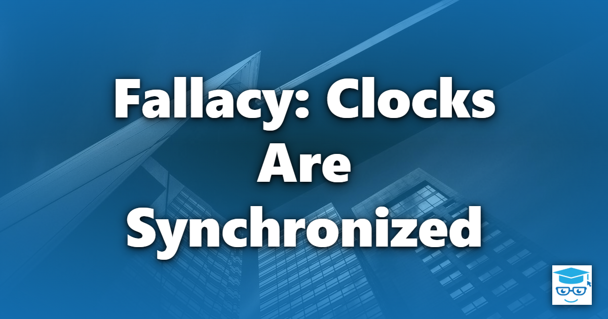

The fallacy that clocks are synchronized is not one of the eight classic [Fallacies of Distributed Computing](/fallacies/), but it quietly corrupts data in many distributed systems. It is the assumption that every machine agrees on what time it is, so a timestamp from one server can be meaningfully compared with a timestamp from another.

## Table of Contents

- [What the Fallacy Assumes](#what-the-fallacy-assumes)
- [Why It's False](#why-its-false)
- [Designing Without Synchronized Clocks](#designing-without-synchronized-clocks)
- [Related Concepts](#related-concepts)
- [References](#references)

## What the Fallacy Assumes

Code written under this fallacy stamps records with the local `DateTime.UtcNow` and later uses those timestamps to decide which update happened first, which write should win, whether a lock or lease has expired, or how long an operation took.

```csharp
// "Last write wins" based on each server's wall clock
if (incoming.UpdatedAt > existing.UpdatedAt)
{
    existing.Apply(incoming);
}
```

If the server that produced `incoming` has a clock running a few seconds behind, its newer update is silently discarded.

## Why It's False

Every computer keeps time with its own imperfect hardware oscillator, and those clocks disagree:

- **Clocks drift.** Quartz clocks gain or lose time at different rates depending on temperature and hardware - commonly tens of parts per million, which adds up to seconds per day.
- **Synchronization is approximate.** NTP corrects drift, but only to within milliseconds in good conditions, and much worse across congested or long-distance networks. A misconfigured or unreachable NTP server can leave a machine minutes off.
- **Clocks jump.** When NTP corrects a clock, it may step it backward or forward. Code measuring durations with wall-clock time can see negative elapsed time.
- **Virtual machines pause.** A VM or container can be suspended, migrated, or starved of CPU, then resume with a stale view of time. Garbage collection pauses have the same effect on a process.
- **Leap seconds and time zones.** Leap-second handling has caused real outages, and local time zones and daylight saving time make wall-clock times ambiguous.

## Designing Without Synchronized Clocks

These are some of the techniques that let systems order events without trusting wall clocks:

- **Use monotonic clocks for durations.** Measure elapsed time and timeouts with a monotonic clock (such as `Stopwatch` in .NET), which never goes backward, not with wall-clock time.
- **Use logical clocks for ordering.** Lamport timestamps establish a consistent order of events across nodes without relying on physical time. Vector clocks additionally detect when two updates were concurrent.
- **Use version numbers.** Optimistic concurrency with a version number or ETag lets the data store, not the clock, decide whether an update is based on the latest state.
- **Let one authority assign order.** A single database, a partition leader, or a log such as Kafka can assign sequence numbers that every consumer agrees on.
- **Handle concurrent updates explicitly.** When two updates genuinely conflict, resolve them with domain rules or data structures designed for merging (CRDTs) rather than picking the one with the larger timestamp.
- **Inject time.** Depend on an abstraction such as `TimeProvider` rather than calling `DateTime.UtcNow` directly, so time-dependent logic can be tested with skewed and jumping clocks.
- **Always use UTC.** Store and transmit timestamps in UTC with explicit offsets, and convert to local time only for display.

Some systems, such as Google Spanner with its TrueTime API, do rely on physical time - but they do so by measuring and exposing clock *uncertainty*, and waiting it out, rather than assuming it is zero.

## Related Concepts

- [Messages Are Delivered Exactly Once, In Order](/fallacies/messages-are-delivered-exactly-once-in-order/) - ordering messages can't rely on timestamps either
- [The Data Is Consistent](/fallacies/the-data-is-consistent/) - clock-based conflict resolution is a common source of inconsistency
- [Explicit Dependencies Principle](/principles/explicit-dependencies-principle/) - make the system clock an explicit, injectable dependency

## References

- [Time, Clocks, and the Ordering of Events in a Distributed System](https://lamport.azurewebsites.net/pubs/time-clocks.pdf) - Leslie Lamport
- [There is No Now](https://queue.acm.org/detail.cfm?id=2745385) - Justin Sheehy, ACM Queue
- [Spanner: Google's Globally-Distributed Database](https://research.google/pubs/spanner-googles-globally-distributed-database-2/) - Corbett et al.
- [TimeProvider Class](https://learn.microsoft.com/dotnet/api/system.timeprovider) - Microsoft Learn
