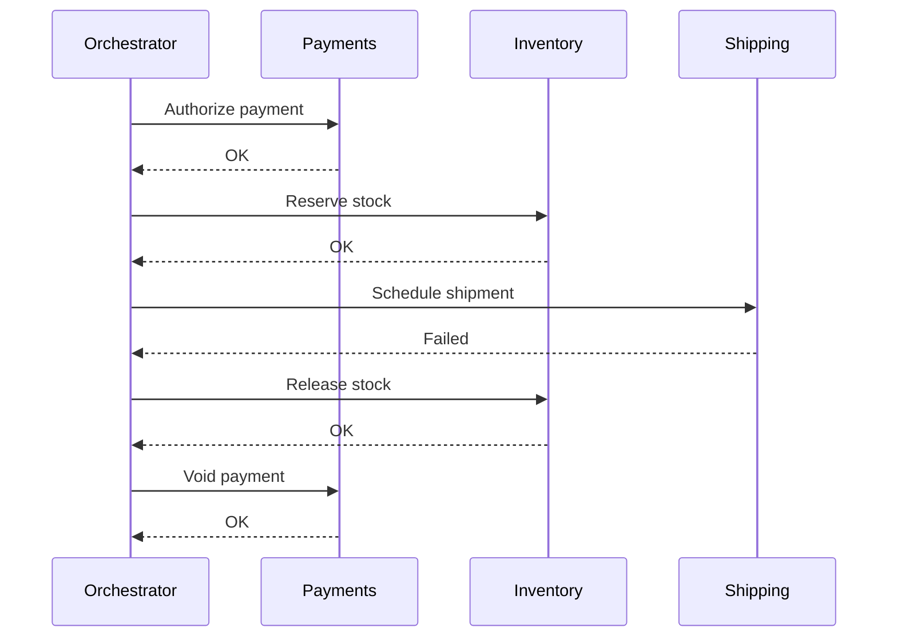
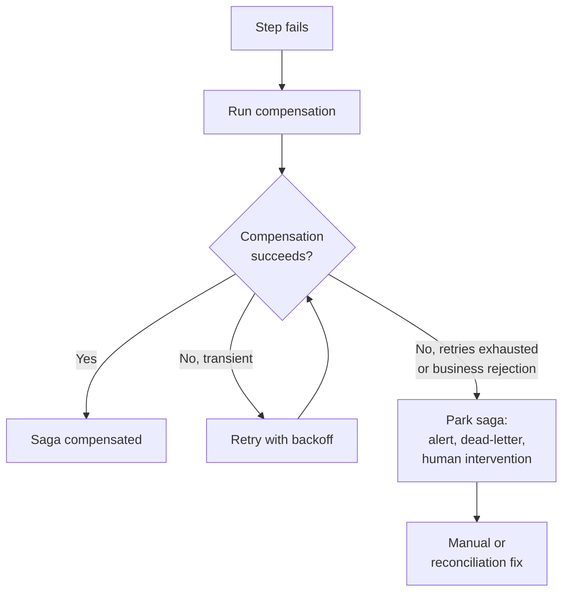

The fallacy that compensating actions are always successful is not one of the eight classic [Fallacies of Distributed Computing](/fallacies/), but it sits at the heart of how many teams handle the consequences of them. It is the assumption that when a multi-step workflow fails partway through, the "undo" for each completed step will run, will work, and will leave the system exactly as it was.

## Table of Contents

- [What the Fallacy Assumes](#what-the-fallacy-assumes)
- [Why It's False](#why-its-false)
- [The Complexity Is Already Hard Enough](#the-complexity-is-already-hard-enough)
- [When Compensations Fail Too](#when-compensations-fail-too)
- [Designing for Failed Compensations](#designing-for-failed-compensations)
- [Related Concepts](#related-concepts)
- [References](#references)

## What the Fallacy Assumes

Without a [distributed transaction](/fallacies/the-data-is-consistent/), there is no automatic rollback across services. The usual substitute is the *saga* pattern: split the business operation into a sequence of local transactions, and for each one define a *compensating action* that semantically reverses it. If step three fails, run the compensations for steps two and one.

Most saga descriptions and diagrams quietly assume that the compensations themselves are reliable:

```csharp
public async Task PlaceOrderAsync(PlaceOrder command)
{
    var completed = new Stack<Func<Task>>();
    try
    {
        var paymentId = await _payments.AuthorizeAsync(command.Payment);
        completed.Push(() => _payments.VoidAsync(paymentId));

        var reservationId = await _inventory.ReserveAsync(command.Items);
        completed.Push(() => _inventory.ReleaseAsync(reservationId));

        await _shipping.ScheduleAsync(command.Address); // fails
    }
    catch
    {
        while (completed.TryPop(out var compensate))
        {
            await compensate(); // naive on purpose: what if this throws, or the process crashes here?
        }
        throw;
    }
}
```

The happy-path compensation loop is easy to write and easy to diagram. It is also incomplete: if `ReleaseAsync` throws, or the process dies between two compensations, nothing records that the saga is half undone.

## Why It's False

Compensating actions are ordinary operations performed across the same [unreliable network](/fallacies/the-network-is-reliable/) as the steps they undo, so they fail for the same reasons - and a few more:

- **They are remote calls.** The service that must be told to void the payment may be down, slow, or throttling you. See [Downstream Capacity Is Infinite](/fallacies/downstream-capacity-is-infinite/).
- **The orchestrator can crash.** If the process coordinating the saga dies midway through compensating, the remaining compensations never run unless the saga's state was persisted.
- **They may run more than once.** Retries and redelivery mean a compensation can be delivered twice, or out of order with the step it compensates. See [Messages Are Delivered Exactly Once, In Order](/fallacies/messages-are-delivered-exactly-once-in-order/).
- **Some steps can't be undone.** You can't unsend an email, unship a package, or take back a legally binding action. At best you can issue a follow-up, such as a correction or a refund.
- **The world moved on.** Between the step and its compensation, other transactions may have changed the data. Restoring the original state can overwrite their work, so the compensation has to apply business rules instead of simply reversing the change.
- **The compensation can be rejected.** A refund can fail because the card was closed. Releasing stock can fail because the warehouse record was archived. Business rules that were satisfied going forward may not be satisfied going back.
- **Compensations are rarely tested.** They run only on failure paths, which are exercised far less than the happy path, so they accumulate bugs that nobody notices until production.

## The Complexity Is Already Hard Enough

Even when compensations are assumed to succeed, sagas are difficult. The coordination style matters, and neither option removes the underlying complexity of the business process:

- **Choreography.** Each service reacts to events from others and publishes its own, with no central coordinator. Services stay loosely coupled, but the overall flow becomes implicit, scattered across services, and hard to see, debug, or change. Compensation logic is distributed as well.
- **Orchestration.** A central orchestrator tells each participant what to do and tracks state. The flow is explicit and easier to reason about, but the orchestrator becomes a coupling point and must itself be made durable and recoverable.
- **No isolation.** Sagas give up the *I* in ACID. Other transactions can see - and act on - the intermediate state of a saga that is later compensated, producing anomalies such as lost updates and dirty reads.
- **Many variants.** *Software Architecture: The Hard Parts* catalogs eight saga patterns, from the simple "Epic Saga" to the "Anthology Saga", by combining three choices: synchronous or asynchronous communication, atomic or eventual consistency, and orchestrated or choreographed coordination. The more asynchronous and eventually consistent the pattern, the more demanding it is to build correctly.

The following diagram shows the happy-path compensation flow that most documentation describes:



Every arrow in that diagram is a network call that can fail, and every participant has its own state. This is the optimistic version.

## When Compensations Fail Too

Now consider what happens when "Release stock" fails. The saga is stuck between two states: the order is failed, but stock is still reserved and the payment is still authorized. Retrying may or may not help. If you add a compensation for the failed compensation, that one can fail too, and the chain has no natural end.



Uwe Friedrichsen makes the sharper form of the argument: sagas suit *business* errors, such as a credit limit violation, which are deterministic and designed for. They are a poor fit for *technical* errors, which are not. A compensation that hits a technical error can itself require compensation, and naively applying the pattern there leaves you with an inconsistent database. Reliably rolling back a partial update across systems after a technical failure starts to look like writing your own two-phase commit.

The result is that accounting for the failure of every compensation multiplies the number of states the system can be in, the number of paths to test, and the number of ways to get paged at 3 a.m. That is intrinsic complexity of distributed systems; no saga variant removes it.

## Designing for Failed Compensations

These are some of the techniques that help limit the damage when compensations fail, and reduce how often they are needed:

- **Make compensations idempotent and retryable.** A compensation that can safely run any number of times can simply be retried until it succeeds. Give each compensation an idempotency key, and treat "already compensated" as success. See [Messages Are Delivered Exactly Once, In Order](/fallacies/messages-are-delivered-exactly-once-in-order/).
- **Persist saga state durably.** Record each completed step, and the compensation for it, before moving on. After a crash the saga can resume where it left off. Use the [Outbox Pattern](/design-patterns/outbox-pattern/) so state changes and the commands or events that follow them are recorded atomically.
- **Retry transient failures before compensating.** Treat as many errors as possible as transient and retry with backoff and jitter. Compensate only when a step fails repeatedly or can't recover.
- **Order steps to minimize compensation.** Put the steps most likely to fail early, and put steps that can't be undone at or after the point where everything else has succeeded. This is often called the *pivot transaction*: the point beyond which the saga can only move forward.
- **Prefer forward recovery after the pivot.** Steps after the pivot are *retriable*: they are designed to eventually succeed, so the saga keeps retrying them rather than compensating. Friedrichsen calls this "eventual completion": keep retrying, with waiting and escalation, until the update succeeds.
- **Use semantic locks.** Mark a record as "pending" (for example, an order in `ApprovalPending` state) so concurrent sagas and users know it is mid-flight and can wait, reject, or behave accordingly. This restores some of the isolation sagas give up.
- **Define a terminal "needs attention" state.** When retries are exhausted, move the saga to an explicit state, publish the failed message to a dead-letter queue, and raise an alert that includes the correlation ID and the reason. A failed saga that nobody notices is the worst outcome.
- **Plan for human intervention.** Some failures can only be resolved by a person: a refund to a closed account, a disputed charge, a shipment already on a truck. Build the tools and runbooks to inspect, retry, skip, or manually complete a stuck saga, and decide in advance who owns that work.
- **Run reconciliation jobs.** Periodically compare the data held by each service and repair or flag differences. Reconciliation is the safety net that catches whatever the saga machinery missed, and it doesn't depend on the saga having noticed the problem.
- **Reduce the need for compensation.** Reserve resources with short-lived, expiring holds, validate everything possible before the first write, and prefer designs where "undo" is simply letting a reservation expire.
- **Avoid distribution where you can.** The best compensation is the one you never need. If a business operation must be atomic, keep its data in one service and one database and use a local transaction. Frequently needing a saga can be a sign that service boundaries cut across a single use case. See [Distributed Monolith](/architecture/distributed-monolith/) and [Modular Monolith](/architecture/modular-monolith/).
- **Make failure observable.** Trace each saga end to end - the original steps and their compensations - with a shared correlation ID. See [Observability](/practices/observability/).

## Related Concepts

- [The Data Is Consistent](/fallacies/the-data-is-consistent/) - sagas exist because distributed data can't be updated atomically
- [The Network Is Reliable](/fallacies/the-network-is-reliable/) - compensations are network calls and fail for the same reasons
- [Messages Are Delivered Exactly Once, In Order](/fallacies/messages-are-delivered-exactly-once-in-order/) - why compensations must be idempotent
- [Failures Are Independent](/fallacies/failures-are-independent/) - the failure that triggered compensation is often correlated with the failure of the compensation
- [Outbox Pattern](/design-patterns/outbox-pattern/) - reliably recording state changes and the messages that drive the next step
- [Event-Driven Architecture](/architecture/event-driven-architecture/) - the style most choreographed sagas are built on
- [Distributed Monolith](/architecture/distributed-monolith/) - distributed transactions and compensating logic are a hidden cost of splitting too early
- [Murphy's Law](/laws/murphys-law/) - the undo can go wrong too

## References

- [Sagas](https://www.cs.cornell.edu/andru/cs711/2002fa/reading/sagas.pdf) - Hector Garcia-Molina and Kenneth Salem, 1987
- [Pattern: Saga](https://microservices.io/patterns/data/saga.html) - Chris Richardson, microservices.io
- [Microservices Patterns](https://microservices.io/book) - Chris Richardson (semantic locks, pivot and retriable transactions)
- [Compensating Transaction pattern](https://learn.microsoft.com/en-us/azure/architecture/patterns/compensating-transaction) - Azure Architecture Center
- [Saga distributed transactions pattern](https://learn.microsoft.com/en-us/azure/architecture/patterns/saga) - Azure Architecture Center
- [Distributed Sagas: A Protocol for Coordinating Microservices](https://www.youtube.com/watch?v=0UTOLRTwOX0) - Caitie McCaffrey (video), and the [slides](https://speakerdeck.com/caitiem20/distributed-sagas-a-protocol-for-coordinating-microservices)
- [Applying the Saga Pattern](https://speakerdeck.com/caitiem20/applying-the-saga-pattern) - Caitie McCaffrey, GOTO Chicago 2015 (slides)
- [The limits of the Saga pattern](https://www.ufried.com/blog/limits_of_saga_pattern/) - Uwe Friedrichsen
- [Saga: How to implement complex business transactions without two phase commit](https://medium.com/@berndruecker/saga-how-to-implement-complex-business-transactions-without-two-phase-commit-e00aa41a1b1b) - Bernd Rücker
- [Transactional Sagas (chapter 12)](https://www.oreilly.com/library/view/software-architecture-the/9781492086888/ch12.html) - *Software Architecture: The Hard Parts*, Neal Ford, Mark Richards, Pramod Sadalage, and Zhamak Dehghani
