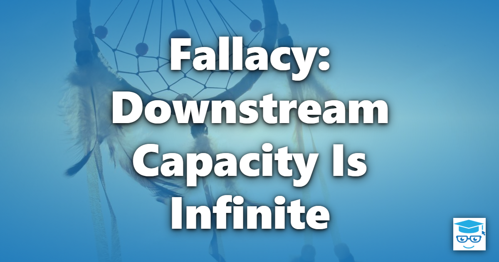

The fallacy that downstream capacity is infinite is not one of the eight classic [Fallacies of Distributed Computing](/fallacies/), but it has become more common as auto-scaling makes it easy to add capacity to *one* part of a system. It is the assumption that whatever you call can keep up with whatever you send it.

## Table of Contents

- [What the Fallacy Assumes](#what-the-fallacy-assumes)
- [Why It's False](#why-its-false)
- [Designing for Limited Downstream Capacity](#designing-for-limited-downstream-capacity)
- [Related Concepts](#related-concepts)
- [References](#references)

## What the Fallacy Assumes

Systems built under this fallacy scale out their web tier during a traffic spike and expect everything behind it to cope. They fire requests at a dependency as fast as work arrives, launch thousands of concurrent tasks against a database, and retry failures immediately. Load tests, if any, exercise one service in isolation against mocked dependencies.

## Why It's False

Capacity in a distributed system is limited by its narrowest point, and scaling one tier just moves the bottleneck downstream:

- **Databases have limits.** Connection pools, locks, I/O, and CPU are finite. Doubling the number of application instances can double the number of database connections - and exhaust them.
- **Third-party APIs have rate limits.** Payment providers, email services, and SaaS APIs throttle callers with HTTP 429 responses or quotas, and may block abusive clients entirely.
- **Not everything auto-scales.** Legacy systems, on-premises services, mainframes, and licensed software often have fixed capacity.
- **Scaling takes time.** Even dependencies that do auto-scale need minutes to add capacity - longer than a sudden spike takes to overwhelm them.
- **Retries multiply load.** When a dependency slows down, callers time out and retry, increasing load at exactly the moment it is least able to handle it.
- **Queues hide the problem until they don't.** An unbounded in-memory queue in front of a slow dependency grows until the process runs out of memory.

## Designing for Limited Downstream Capacity

These are some of the techniques that help systems respect the limits of their dependencies:

- **Know your limits.** Document the capacity, rate limits, and quotas of each dependency, and load test the system end to end with realistic dependencies.
- **Rate limit outgoing calls.** Throttle calls to a dependency to stay within its limits, and honor `Retry-After` headers and 429 responses.
- **Bound concurrency.** Limit the number of concurrent requests to each dependency, and size connection pools based on what the dependency can handle, not on how many instances you run.
- **Apply backpressure.** When downstream components can't keep up, slow down or reject upstream work rather than buffering without limit. Use bounded queues and channels.
- **Buffer with durable queues.** A message queue lets work arrive faster than it can be processed and drains at a sustainable rate. See [Web-Queue-Worker](/architecture/web-queue-worker-architecture/) and [Competing Consumers](/architecture/competing-consumers/).
- **Shed load gracefully.** When overloaded, reject low-priority work quickly so high-priority work still succeeds, rather than slowing everything down until everything fails.
- **Protect yourself too.** Rate limit your own APIs so your callers can't overwhelm you - you are someone else's downstream dependency.
- **Retry responsibly.** Use exponential backoff with jitter, cap the number of retries, and use circuit breakers to stop calling an overloaded dependency. See [Fail Fast](/principles/fail-fast/).

## Related Concepts

- [Failures Are Independent](/fallacies/failures-are-independent/) - overload is a common way that one failure triggers others
- [Bandwidth Is Infinite](/fallacies/bandwidth-is-infinite/) - network capacity is one more downstream limit
- [Web-Queue-Worker Architecture](/architecture/web-queue-worker-architecture/) - decoupling request intake from processing
- [Competing Consumers](/architecture/competing-consumers/) - scaling the processing of queued work
- [Amdahl's Law](/laws/amdahls-law/) - the parts you can't scale limit the speedup of the whole

## References

- [Rate limiting middleware in ASP.NET Core](https://learn.microsoft.com/aspnet/core/performance/rate-limit) - Microsoft Learn
- [Using load shedding to avoid overload](https://aws.amazon.com/builders-library/using-load-shedding-to-avoid-overload/) - Amazon Builders' Library
- [Handling Overload](https://sre.google/sre-book/handling-overload/) - Google, Site Reliability Engineering
- [Throttling pattern](https://learn.microsoft.com/azure/architecture/patterns/throttling) - Azure Architecture Center
