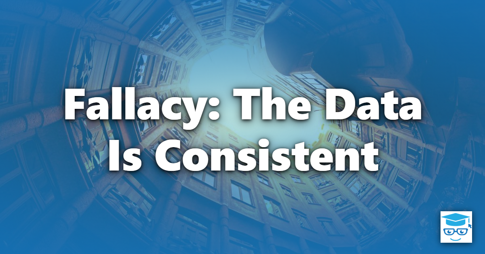

The fallacy that the data is consistent is not one of the eight classic [Fallacies of Distributed Computing](/fallacies/), but it is one of the most common assumptions carried over from single-database applications. It is the belief that once data is written, every reader everywhere immediately sees the new value.

## Table of Contents

- [What the Fallacy Assumes](#what-the-fallacy-assumes)
- [Why It's False](#why-its-false)
- [CAP and PACELC](#cap-and-pacelc)
- [Designing for Eventual Consistency](#designing-for-eventual-consistency)
- [Related Concepts](#related-concepts)
- [References](#references)

## What the Fallacy Assumes

In a single relational database, a transaction either commits completely or not at all, and once it commits, every subsequent query sees the result. Code written under this fallacy expects the same guarantees across services, replicas, and caches. It writes to one service and immediately reads from another, expects a cache to reflect the latest change, or tries to update several services as though they were one atomic operation.

The classic symptom: a user saves a change, the page reloads, and their change isn't there - because the read came from a replica or read model that hasn't caught up yet.

## Why It's False

As soon as data lives in more than one place, copies can disagree:

- **Replication lags.** Read replicas apply changes after the primary commits them - usually within milliseconds, but sometimes seconds or minutes under load or after a failure.
- **Caches go stale.** A cached value is a copy with no automatic connection to the source. Invalidation is famously hard to get right.
- **Read models trail write models.** In [CQRS](/design-patterns/cqrs-pattern/) and [event-driven](/architecture/event-driven-architecture/) systems, read models are updated asynchronously from events.
- **Each service owns its own data.** When services each have their own database, there is no single transaction that spans them. A process that updates three services can fail after the first.
- **Distributed transactions rarely help.** Two-phase commit exists, but it is slow, reduces availability, and is unsupported by most modern message brokers and cloud data stores.

## CAP and PACELC

The CAP theorem states that when a network partition occurs, a distributed data store must choose between **consistency** (every read sees the latest write) and **availability** (every request gets a response). Since partitions [will happen](/fallacies/the-network-is-reliable/), the real choice is which one to give up when they do.

PACELC extends this: if there is a **P**artition, choose **A**vailability or **C**onsistency; **E**lse, even when everything is healthy, choose between **L**atency and **C**onsistency. Strong consistency always costs something, even on a good day, because replicas must coordinate before answering.

## Designing for Eventual Consistency

These are some of the techniques that help systems work correctly when data is not immediately consistent:

- **Choose consistency boundaries deliberately.** Keep data that must be strongly consistent together, within a single [Aggregate](/domain-driven-design/aggregate-pattern/) and a single transaction. Accept eventual consistency between aggregates and between [Bounded Contexts](/domain-driven-design/bounded-context/).
- **Use sagas instead of distributed transactions.** Model multi-service processes as a sequence of local transactions, each with a compensating action that undoes it if a later step fails.
- **Provide read-your-writes where it matters.** Route a user's reads to the primary for a short time after they write, return the updated state from the write itself, or have the UI wait for a version number to appear in the read model.
- **Design the user experience for it.** Show "processing" states, confirm that a request was *accepted* rather than *completed*, and update the UI optimistically.
- **Make staleness explicit.** Set cache durations consciously, include version numbers or timestamps on data, and decide how stale each piece of data is allowed to be.
- **Detect and reconcile.** Run periodic reconciliation jobs that compare systems and fix discrepancies, rather than assuming they can never occur.
- **Talk to the business.** Many business processes are already eventually consistent - orders are confirmed before stock is checked, and payments clear days later. Domain experts can usually tell you how much inconsistency is acceptable.

## Related Concepts

- [CQRS Pattern](/design-patterns/cqrs-pattern/) - separate read and write models that are often eventually consistent
- [Aggregate Pattern](/domain-driven-design/aggregate-pattern/) - the natural boundary for strong consistency
- [Outbox Pattern](/design-patterns/outbox-pattern/) - keeping a database change and its outgoing message consistent
- [Clocks Are Synchronized](/fallacies/clocks-are-synchronized/) - why timestamps can't resolve conflicting updates
- [Messages Are Delivered Exactly Once, In Order](/fallacies/messages-are-delivered-exactly-once-in-order/) - why replicas and read models receive updates in unpredictable ways

## References

- [Brewer's Conjecture and the Feasibility of Consistent, Available, Partition-Tolerant Web Services](https://dl.acm.org/doi/10.1145/564585.564601) - Seth Gilbert and Nancy Lynch
- [Consistency Tradeoffs in Modern Distributed Database System Design](https://www.cs.umd.edu/~abadi/papers/abadi-pacelc.pdf) - Daniel Abadi (PACELC)
- [Eventually Consistent](https://www.allthingsdistributed.com/2008/12/eventually_consistent.html) - Werner Vogels
- [Sagas](https://www.cs.cornell.edu/andru/cs711/2002fa/reading/sagas.pdf) - Hector Garcia-Molina and Kenneth Salem
