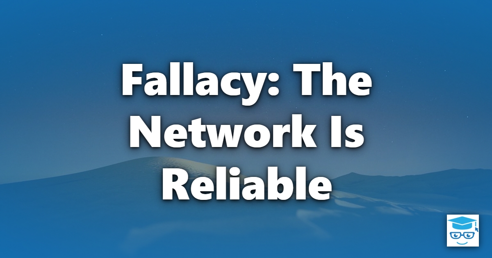

The first, and most fundamental, of the [Fallacies of Distributed Computing](/fallacies/) is the assumption that the network is reliable: that when one component sends a message to another, the message will arrive, the receiver will process it, and the response will make it back.

## Table of Contents

- [What the Fallacy Assumes](#what-the-fallacy-assumes)
- [Why It's False](#why-its-false)
- [The Hardest Case: Not Knowing](#the-hardest-case-not-knowing)
- [Designing for an Unreliable Network](#designing-for-an-unreliable-network)
- [Related Concepts](#related-concepts)
- [References](#references)

## What the Fallacy Assumes

Code written under this fallacy treats a remote call exactly like a local one. It calls an HTTP endpoint, writes to a database, or publishes a message, and assumes success. There is no timeout, no retry, and no plan for what the rest of the system should do if the call never completes.

```csharp
// Assumes the network is reliable
var order = await _httpClient.GetFromJsonAsync<Order>($"/orders/{id}");
await _paymentClient.ChargeAsync(order.Total);
await _shippingClient.ScheduleAsync(order);
```

If the payment call succeeds and the shipping call fails, the customer has been charged for an order that will never ship - and nothing in this code will ever notice.

## Why It's False

Networks fail in many ways, and at scale, they fail constantly:

- **Hardware fails.** Switches, routers, network cards, and cables break. Power supplies fail. Data centers lose power.
- **Software fails.** Load balancers are misconfigured, DNS servers return stale records, firewalls drop connections that are idle too long, and TLS certificates expire.
- **Dependencies fail.** The service on the other end may be deploying, crashed, overloaded, or throttling you.
- **Cloud infrastructure fails.** Entire availability zones and regions have had outages. Managed services have their own incidents and maintenance windows.
- **People fail.** Someone unplugs the wrong cable, pushes a bad firewall rule, or deletes a route table.

Even when each individual component is very reliable, a request that crosses many components multiplies their failure rates. A call chain through ten services that are each 99.9% available is only about 99% available.

## The Hardest Case: Not Knowing

A failed call is not the worst outcome. The worst outcome is a call that *times out*. When a request times out, the caller does not know whether:

- the request never reached the server,
- the server received it and failed while processing it, or
- the server processed it successfully and the response was lost on the way back.

Retrying blindly may cause the operation to happen twice. Not retrying may mean it never happens at all. This is why reliability in distributed systems is so closely tied to idempotency.

## Designing for an Unreliable Network

These are some of the techniques that help systems cope with an unreliable network:

- **Timeouts everywhere.** Never make a remote call without a timeout. A call that waits forever ties up threads, connections, and memory, and can take down the caller along with the callee.
- **Retries with backoff and jitter.** Many failures are transient. Retry them, but back off exponentially and add randomness so that many clients don't retry in lockstep and overwhelm a recovering service.
- **Idempotent operations.** Design operations so that performing them more than once has the same effect as performing them once, typically by including an idempotency key or message ID that the receiver uses to detect duplicates.
- **Circuit breakers.** Stop calling a dependency that is clearly failing, fail fast instead, and periodically probe it to see if it has recovered. See [Fail Fast](/principles/fail-fast/).
- **Asynchronous messaging.** Durable message queues decouple the sender from the receiver so a temporary outage delays work rather than losing it. See [Event-Driven Architecture](/architecture/event-driven-architecture/) and [Competing Consumers](/architecture/competing-consumers/).
- **The Outbox Pattern.** Save outgoing messages in the same transaction as your data change, and publish them separately, so a network failure can't leave the two out of sync. See the [Outbox Pattern](/design-patterns/outbox-pattern/).
- **Graceful degradation.** Decide in advance what the user should see when a non-essential dependency is unavailable - cached data, a reduced feature set, or a clear message - rather than an unhandled exception.
- **Chaos testing.** Deliberately inject network failures in test and staging environments to verify that your handling actually works.

Libraries such as [Polly](https://www.pollydocs.org/) (and the resilience features built on it in .NET) make timeouts, retries, and circuit breakers straightforward to apply consistently.

## Related Concepts

- [Latency Is Zero](/fallacies/latency-is-zero/) - the closely related assumption that remote calls are fast
- [Topology Doesn't Change](/fallacies/topology-doesnt-change/) - a frequent cause of network failures
- [Outbox Pattern](/design-patterns/outbox-pattern/) - reliably publishing messages alongside database changes
- [Fail Fast](/principles/fail-fast/) - surfacing failures quickly instead of hanging
- [Murphy's Law](/laws/murphys-law/) - anything that can go wrong will go wrong

## References

- [Fallacies of Distributed Computing Explained](https://www.rgoarchitects.com/Files/fallacies.pdf) - Arnon Rotem-Gal-Oz
- [Timeouts, retries, and backoff with jitter](https://aws.amazon.com/builders-library/timeouts-retries-and-backoff-with-jitter/) - Amazon Builders' Library
- [Circuit Breaker](https://martinfowler.com/bliki/CircuitBreaker.html) - Martin Fowler
- [Polly](https://www.pollydocs.org/) - .NET resilience and transient-fault-handling library
