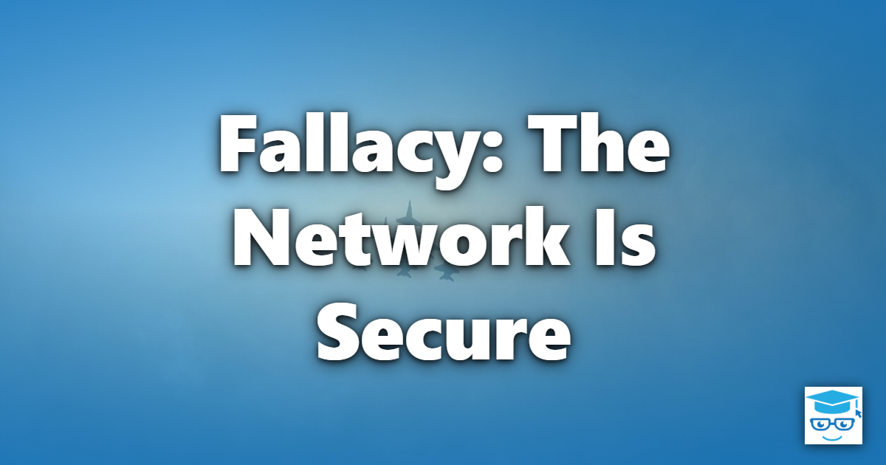

The fourth of the [Fallacies of Distributed Computing](/fallacies/) is the assumption that the network is secure: that the only parties on the network are the ones you expect, and that nobody is reading, modifying, or forging your traffic.

## Table of Contents

- [What the Fallacy Assumes](#what-the-fallacy-assumes)
- [Why It's False](#why-its-false)
- [Designing for a Hostile Network](#designing-for-a-hostile-network)
- [Related Concepts](#related-concepts)
- [References](#references)

## What the Fallacy Assumes

Code written under this fallacy sends data in plain text between internal services, skips authentication for calls that come from "inside," trusts any request that arrives from a known IP range, and relies on a perimeter firewall as the only line of defense. The reasoning is usually some form of "it's on our private network, so it's safe."

## Why It's False

The perimeter model of security - a hard shell around a soft, trusted interior - has failed repeatedly:

- **Attackers get inside.** Phishing, stolen credentials, vulnerable dependencies, and compromised developer machines all give attackers a foothold on the "trusted" network. Once inside, a flat, unauthenticated network lets them move laterally to anything.
- **Networks are shared.** Cloud workloads run on shared infrastructure. Users connect from coffee-shop Wi-Fi. Traffic crosses networks owned by ISPs, cloud providers, and partners you've never audited.
- **Insiders exist.** Not every threat comes from outside, and not every insider threat is malicious - misconfigured tools and over-privileged service accounts cause real damage too.
- **Boundaries blur.** Partner integrations, SaaS products, mobile clients, and remote workers mean there is no longer a clear inside and outside.
- **Security is everyone's problem.** A single unencrypted internal endpoint, leaked secret, or permissive firewall rule can undo the rest of your defenses.

## Designing for a Hostile Network

These are some of the techniques that help systems remain secure on networks that aren't:

- **Assume breach (Zero Trust).** Treat every network, including your internal one, as hostile. Verify every request explicitly, regardless of where it came from.
- **Encrypt in transit everywhere.** Use TLS for all traffic, including service-to-service calls and database connections. Consider mutual TLS (mTLS) between services, often provided by a service mesh or [Sidecar](/architecture/sidecar-pattern/).
- **Authenticate every caller.** Services as well as users should prove their identity, using tokens, managed identities, or certificates rather than shared passwords or IP allow-lists. See [Authentication](/practices/authentication/).
- **Authorize every operation.** Knowing who the caller is isn't enough; check that they're allowed to do what they're asking, and grant the least privilege needed. See [Authorization](/practices/authorization/).
- **Validate all input.** Treat data from other services with the same suspicion as data from users. See [Parse, Don't Validate](/principles/parse-dont-validate/).
- **Manage secrets properly.** Keep keys and connection strings out of source control and configuration files, store them in a secrets manager, and rotate them.
- **Segment the network.** Limit which components can talk to which, so a compromise in one place can't reach everything.
- **Log and monitor security events.** You can't respond to an attack you can't see. See [Observability](/practices/observability/).

Security is a cross-cutting concern that must be designed in from the start. Retrofitting it into a system built on the assumption of a trusted network is far more difficult and expensive.

## Related Concepts

- [Authentication](/practices/authentication/) and [Authorization](/practices/authorization/) - verifying identity and permissions on every request
- [There Is One Administrator](/fallacies/there-is-one-administrator/) - many parties control parts of the network, each with their own security policies
- [Kerckhoff's Principle](/laws/kerckhoffs-principle/) - a system should be secure even if everything about it except the key is public
- [Sidecar Pattern](/architecture/sidecar-pattern/) - a common way to add mTLS and policy enforcement to services

## References

- [Zero Trust Architecture (NIST SP 800-207)](https://csrc.nist.gov/pubs/sp/800/207/final) - National Institute of Standards and Technology
- [OWASP Top Ten](https://owasp.org/www-project-top-ten/) - Open Worldwide Application Security Project
- [Fallacies of Distributed Computing Explained](https://www.rgoarchitects.com/Files/fallacies.pdf) - Arnon Rotem-Gal-Oz
