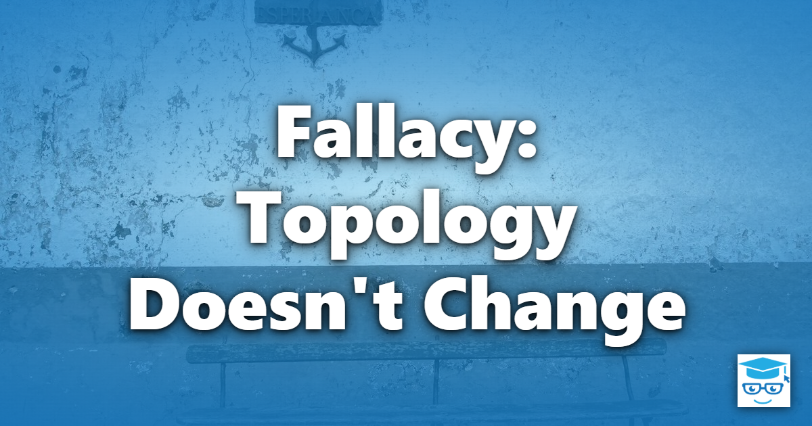

The fifth of the [Fallacies of Distributed Computing](/fallacies/) is the assumption that topology doesn't change: that the servers, addresses, and network paths a system depends on will stay where they are.

## Table of Contents

- [What the Fallacy Assumes](#what-the-fallacy-assumes)
- [Why It's False](#why-its-false)
- [Designing for a Changing Topology](#designing-for-a-changing-topology)
- [Related Concepts](#related-concepts)
- [References](#references)

## What the Fallacy Assumes

A network's topology is its shape: which nodes exist, how they're connected, and how traffic flows between them. Code written under this fallacy hard-codes IP addresses and host names, caches DNS lookups forever, assumes a fixed number of instances, and relies on a particular route or latency between two components.

## Why It's False

In the era when the fallacies were written, servers were physical machines that might sit in the same rack for years. Even then, topology changed more often than people expected. Today, change is the normal state of affairs:

- **Instances are ephemeral.** Containers, serverless functions, and auto-scaling groups create and destroy instances continuously. An address that was valid a minute ago may now belong to a different service - or to nothing.
- **Deployments move things.** Blue-green and rolling deployments, failovers, and region migrations deliberately change where traffic goes.
- **Infrastructure changes underneath you.** Cloud providers replace hardware, network teams re-architect subnets, and load balancers are added or removed.
- **Clients move.** Mobile devices switch between Wi-Fi and cellular networks, change IP addresses, and go offline entirely.
- **Failures reshape the network.** When a link or node fails, traffic is rerouted, changing latency and capacity characteristics without warning.

## Designing for a Changing Topology

These are some of the techniques that help systems cope with a changing topology:

- **Never hard-code addresses.** Refer to dependencies by logical name and resolve them through configuration, DNS, or a service discovery mechanism.
- **Use service discovery and load balancers.** Let a registry, DNS, Kubernetes services, or a load balancer track where healthy instances currently live.
- **Respect DNS TTLs.** Don't cache resolved addresses indefinitely. Be aware of client libraries and connection pools that do so by default.
- **Treat instances as disposable.** Design services to be stateless, or to externalize state, so any instance can be replaced at any time.
- **Use health checks.** Let the platform detect and stop routing to unhealthy instances.
- **Communicate through stable intermediaries.** Message brokers and API gateways give producers and consumers a fixed point to connect to, even as the instances behind them change. See [Competing Consumers](/architecture/competing-consumers/).
- **Practice change.** Regularly kill instances, fail over, and redeploy in non-production environments so that topology change is routine rather than an emergency.

## Related Concepts

- [The Network Is Reliable](/fallacies/the-network-is-reliable/) - topology changes are a frequent source of failed calls
- [There Is One Administrator](/fallacies/there-is-one-administrator/) - topology often changes because someone else changed it
- [Competing Consumers](/architecture/competing-consumers/) - decoupling producers from a changing set of consumers
- [Sidecar Pattern](/architecture/sidecar-pattern/) - offloading discovery and routing to infrastructure

## References

- [Fallacies of Distributed Computing Explained](https://www.rgoarchitects.com/Files/fallacies.pdf) - Arnon Rotem-Gal-Oz
- [Service discovery in .NET](https://learn.microsoft.com/dotnet/core/extensions/service-discovery) - Microsoft Learn
- [The Twelve-Factor App](https://12factor.net/) - in particular, backing services and disposability
