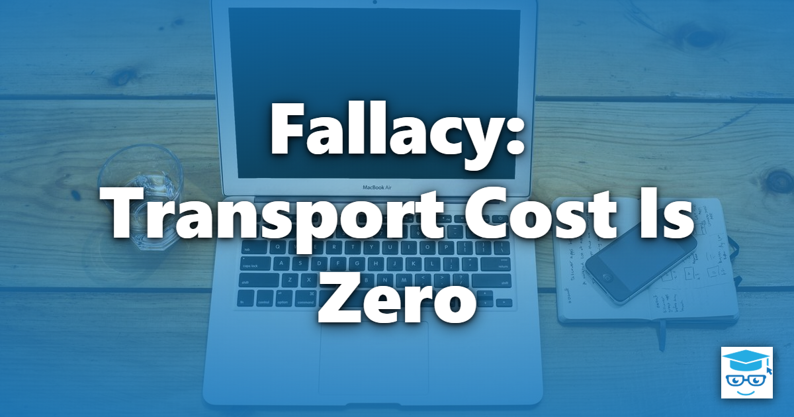

The seventh of the [Fallacies of Distributed Computing](/fallacies/) is the assumption that transport cost is zero: that sending data from one place to another costs nothing beyond the time it takes.

## Table of Contents

- [What the Fallacy Assumes](#what-the-fallacy-assumes)
- [Why It's False](#why-its-false)
- [Designing With Transport Costs in Mind](#designing-with-transport-costs-in-mind)
- [Related Concepts](#related-concepts)
- [References](#references)

## What the Fallacy Assumes

Code written under this fallacy treats a network call as a free operation. It splits work across many services without considering the overhead of each hop, serializes large and verbose payloads, chooses architectures that move data across regions on every request, and is surprised by the monthly cloud bill.

## Why It's False

Transport cost has two parts, and both are real.

The first is **computational overhead**. Before data can cross the network, it must be converted from in-memory objects into bytes, and converted back on the other side. Serialization, encryption, compression, and protocol handling all consume CPU and memory on both ends. Every proxy, load balancer, gateway, and service mesh sidecar along the way adds more. In a busy system, a substantial share of compute can go to moving data around rather than doing useful work.

The second is **monetary cost**. Somebody pays for the network:

- **Cloud egress fees.** Cloud providers typically charge for data leaving a region, crossing availability zones, or going out to the internet. These charges can dominate the bill for data-heavy architectures.
- **Infrastructure.** Load balancers, NAT gateways, VPNs, dedicated links, API gateways, and message brokers are all billed, often per gigabyte or per request.
- **Per-call pricing.** Many third-party APIs and serverless platforms charge per request, so a chatty design directly multiplies cost.
- **Your users' costs.** Mobile users on metered plans pay for every byte your app downloads.

## Designing With Transport Costs in Mind

These are some of the techniques that help systems keep transport costs under control:

- **Don't distribute without a reason.** Every service boundary adds transport cost to every interaction that crosses it. Keep components that communicate heavily in the same process unless there's a compelling reason to separate them. See [Modular Monolith](/architecture/modular-monolith/).
- **Keep data close to compute.** Run services in the same region and availability zone as the data they use most, and avoid architectures that send every request across regions.
- **Choose efficient formats.** For high-volume internal traffic, compact binary serialization (such as Protocol Buffers or MessagePack) is cheaper to produce, transmit, and parse than verbose text formats.
- **Send less.** Shape payloads for their purpose, compress them, and cache aggressively. See [Bandwidth Is Infinite](/fallacies/bandwidth-is-infinite/).
- **Batch work.** Many small messages cost more in per-request overhead and fees than fewer, larger ones.
- **Measure cost as a metric.** Track data transfer and per-request charges alongside performance metrics, and include them in architecture decisions.

## Related Concepts

- [Bandwidth Is Infinite](/fallacies/bandwidth-is-infinite/) - moving less data reduces both congestion and cost
- [Latency Is Zero](/fallacies/latency-is-zero/) - every hop costs time as well as money
- [Distributed Monolith](/architecture/distributed-monolith/) - paying the transport cost of distribution without gaining independence
- [Eliminate Waste](/principles/eliminate-waste/) - unnecessary data movement is a form of waste

## References

- [Fallacies of Distributed Computing Explained](https://www.rgoarchitects.com/Files/fallacies.pdf) - Arnon Rotem-Gal-Oz
- [Overview of data transfer costs for common architectures](https://aws.amazon.com/blogs/architecture/overview-of-data-transfer-costs-for-common-architectures/) - AWS Architecture Blog
- [Serialization in .NET](https://learn.microsoft.com/dotnet/standard/serialization/) - Microsoft Learn
