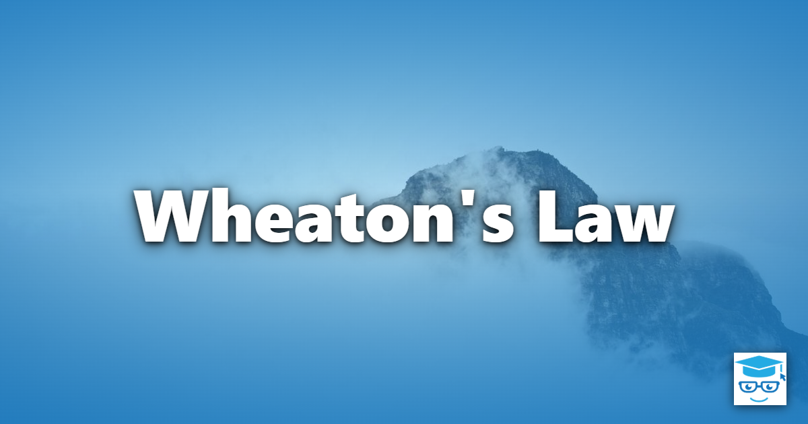

*"Don't be a dick."* — Wil Wheaton

Wheaton's Law is the shortest law in this collection, and arguably the hardest to follow consistently. It asks one thing of you: treat the people you interact with decently. It was coined with online gamers in mind, but it applies just as well to software teams, open source communities, and nearly every other place where people work together.

## Table of Contents

- [Table of Contents](#table-of-contents)
- [Origin](#origin)
- [The Law Stated](#the-law-stated)
- [Why It Matters to Software Teams](#why-it-matters-to-software-teams)
- [Wheaton's Law in Practice](#wheatons-law-in-practice)
- [What the Law Does Not Mean](#what-the-law-does-not-mean)
- [Relation to Other Principles](#relation-to-other-principles)
- [References](#references)

## Origin

Wil Wheaton is an actor, author, and long-time gaming advocate. In 2007 he delivered the keynote address at PAX (the Penny Arcade Expo), a large gaming convention. In that talk he spoke to the gaming community about how players treat one another, and his advice was simple: don't be a dick. The idea stuck, and became known as Wheaton's Law.

Although the talk was about gamers, the idea is not specific to games. Anywhere people communicate through a screen, with little context about each other and few immediate consequences, it is easy to be dismissive, sarcastic, or cruel. Software development is full of such places.

## The Law Stated

> Don't be a dick.

The law is intentionally blunt. It does not come with a rubric, a list of banned words, or a process. It works as a gut check you can apply to a comment before you post it or a decision before you make it: *would I be comfortable if the other person watched me say this, and would I say it the same way to their face?*

## Why It Matters to Software Teams

Software is built by people, collaboratively. How people treat each other directly affects the quality of what they build:

- **People stop speaking up.** If raising a concern, asking a question, or admitting a mistake gets you mocked, you quickly learn to stay quiet. Problems that could have been caught early stay hidden.
- **Good people leave.** Talented developers can usually find another team or project. A hostile environment drives them away, and the people who remain are often the ones with the fewest options.
- **Feedback loses its value.** Feedback delivered with contempt triggers defensiveness rather than learning, so the useful content in it is ignored.
- **Collaboration costs more.** Teams that spend energy managing egos and avoiding conflict have less energy left for the actual work.

## Wheaton's Law in Practice

### Code Reviews

A code review is a conversation about code, not a verdict on its author. Compare these two comments on the same pull request.

A dismissive comment:

> This is a terrible approach. Did you even read the docs?

A constructive one:

> This loads every order into memory before filtering. Could we push the filter into the query instead? It should cut memory use a lot for large customers.

Both comments identify the same problem. Only the second is likely to get it fixed and leave the author willing to submit another pull request. Critique the code, explain your reasoning, and where possible ask questions or offer a concrete suggestion. The same goes for receiving a review: assume good intent, and don't respond to a critique of your code as though it were a critique of you.

### Open Source Maintainers and Contributors

Open source projects are often staffed by volunteers, and the interactions are mostly between strangers. Maintainers are frequently overworked and asked to provide unpaid support, and contributors are often submitting their first pull request. Both groups benefit from the law:

- Maintainers can decline a contribution without belittling the person who made it, and can explain why.
- Contributors can remember that a maintainer owes them nothing, and that demanding updates on an issue every day is not helping.
- Everyone can remember that the person on the other end of an issue thread is a human being having their own day.

### Incident Postmortems

After an outage, it is tempting to look for who is at fault. A blameless postmortem is Wheaton's Law applied to incident response: focus on the conditions that allowed the mistake to happen (missing safeguards, unclear documentation, confusing tooling) rather than on the person who happened to make it. People who are not afraid of being blamed are far more willing to describe exactly what happened, which is what the team needs in order to prevent a repeat.

### Q&A Sites, Forums, and Chat

Everyone asking a question in a forum or on a Q&A site was once a beginner. A reply of "just Google it" or a downvote with no explanation helps nobody. If a question is a duplicate or lacks detail, say so politely and point to what is needed. If you don't want to help, you are free not to reply.

### Meetings and Daily Work

The law also applies outside of code. Talking over colleagues, taking credit for other people's work, belittling a junior colleague's question, or firing off a curt message in team chat while frustrated are all ways to be a dick, and all of them damage a team over time.

## What the Law Does Not Mean

Following Wheaton's Law does not mean avoiding disagreement or hiding problems:

- **You can be direct.** Clear, honest technical feedback is kind. Vague praise that leaves a defect in the codebase is not.
- **You can say no.** Rejecting a pull request, pushing back on a deadline, or declining a feature request is part of the job.
- **You can have strong opinions.** The law is about how you express them and how you treat the people who disagree.

The difference is between criticizing an idea and diminishing a person.

## Relation to Other Principles

- **[Postel's Law](../postels-law/)** — "be conservative in what you send, liberal in what you accept" was written about network protocols, but it makes a decent rule for communicating with colleagues too: be careful in what you say, and generous in how you interpret what others say to you.
- **[Respect People](/principles/respect-people/)** — the Lean Software Development principle holds that the people doing the work are best placed to improve it. That only works in an environment where they are treated with respect.
- **[Respect](/values/respect/)**, **[Communication](/values/communication/)**, and **[Feedback](/values/feedback/)** — values that Wheaton's Law supports in everyday behavior.
- **[Pair Programming](/practices/pair-programming/)** — working side by side requires courtesy and patience, and builds empathy for how others think.
- **[Collective Code Ownership](/practices/collective-code-ownership/)** — when anyone may change any code, reviews and edits must be given and received without ego.
- **[Boy Scout Rule](/principles/boy-scout-rule/)** — leave the codebase better than you found it; the same applies to the team and community you work in.
- **[Conway's Law](../conways-law/)** — the communication patterns of a team shape the systems it builds, so toxic communication tends to show up in the architecture.

## References

1. Wheaton, Wil. [PAX 2007 keynote (audio)](http://s3.amazonaws.com/media.penny-arcade.com/PAX07_Keynote.mp3) — Penny Arcade Expo, 2007.
2. [Wheaton's Law video](https://www.youtube.com/watch?v=t3ICRoe-QIw) — YouTube.
3. [Wil Wheaton — Wikipedia](https://en.wikipedia.org/wiki/Wil_Wheaton)
