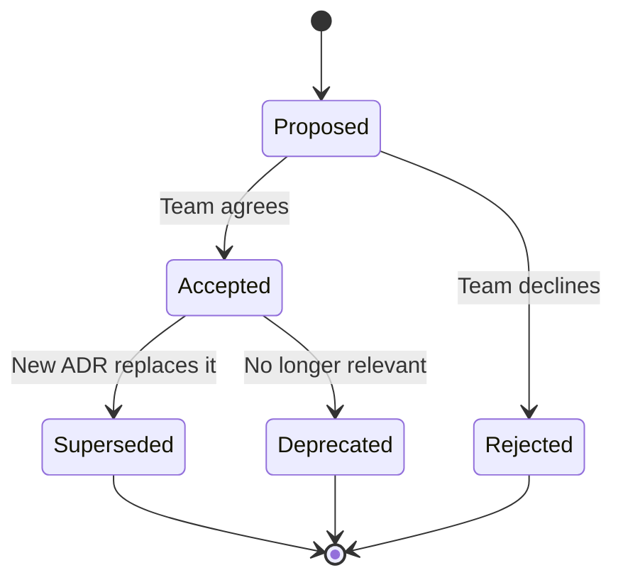

*"Why on earth did we do it this way?"* — Every developer who has joined a long-lived project

Every software project is the sum of thousands of decisions: the framework, the database, how services communicate, how errors are handled, which library does the logging. The code records *what* was decided. It almost never records *why*, what alternatives were rejected, or what trade-offs the team knowingly accepted. Months or years later, new team members (and the original authors) are left to guess, and the same debates happen again.

An **Architecture Decision Record (ADR)** is a short document that captures a single architecturally significant decision along with its context and consequences. A collection of ADRs forms a decision log that explains how a system arrived at its current shape.

## Table of Contents

- [Why Write ADRs?](#why-write-adrs)
- [What Deserves an ADR?](#what-deserves-an-adr)
- [Anatomy of an ADR](#anatomy-of-an-adr)
- [ADR Lifecycle](#adr-lifecycle)
- [Where to Store ADRs](#where-to-store-adrs)
- [Tooling](#tooling)
- [Tips and Pitfalls](#tips-and-pitfalls)
- [Related Practices](#related-practices)
- [References](#references)

## Why Write ADRs?

ADRs address a handful of recurring problems:

- **Lost context.** The reasoning behind a decision lives in people's heads, chat threads, and meeting notes. When people leave, the reasoning leaves with them.
- **Re-litigating settled questions.** Without a record, a new team member (or a new manager) reasonably asks "why didn't you just use X?" and the team repeats a discussion it already had. An ADR lets you point to the alternatives that were considered and why they lost.
- **Faster onboarding.** Reading the decision log is one of the quickest ways to understand why a system looks the way it does.
- **Better decisions.** Writing down the context, options, and consequences forces clearer thinking. Weak arguments tend to fall apart when you have to put them in writing.
- **Safer change.** When circumstances change, a team can see which assumptions a decision relied on and decide whether it is still valid, rather than fearing or blindly keeping legacy choices.

The absence of this practice is a symptom of [Architecture by Implication](/antipatterns/architecture-by-implication/) and [YOLO Architecture](/practices/yolo-architecture/), where the architecture exists only as unwritten tribal knowledge.

## What Deserves an ADR?

Not every decision needs a record. A useful rule of thumb is to write an ADR for decisions that are *architecturally significant*: they are costly to reverse, they affect many parts of the system, or they involve meaningful trade-offs. Typical examples include:

- Choice of programming language, framework, or major library
- Persistence technology and data-access approach
- Application [architecture style](/architecture/) (for example [Clean Architecture](/architecture/clean-architecture/) or [Vertical Slice Architecture](/architecture/vertical-slice-architecture/))
- Hosting, deployment, and infrastructure choices
- Integration and communication approaches between services
- Cross-cutting concerns such as logging, authentication, and error handling
- Testing strategy and tooling

Decisions that took real discussion, research, or debate are the best candidates. Team conventions that everyone already agrees on, or issues that are unlikely to come up again, usually are not worth the overhead.

## Anatomy of an ADR

The most widely used format comes from Michael Nygard's 2011 post, *Documenting Architecture Decisions*. It keeps each record to one or two pages with five sections:

| Section          | Purpose                                                                              |
| ---------------- | ------------------------------------------------------------------------------------ |
| **Title**        | A short noun phrase, usually numbered (for example, "ADR 007: Use PostgreSQL").      |
| **Status**       | Where the decision is in its lifecycle: proposed, accepted, deprecated, superseded.  |
| **Context**      | The forces at play: requirements, constraints, and facts that make this a decision.  |
| **Decision**     | The choice the team made, written in full sentences and active voice ("We will..."). |
| **Consequences** | The resulting context: benefits, costs, and new problems the decision creates.       |

Other templates extend this core. [MADR](https://github.com/adr/madr) (Markdown Architectural Decision Records) adds explicit sections for decision drivers and considered options with pros and cons. Others add fields for decision makers, dates, or links to related records. The [ADR GitHub organization](https://adr.github.io/) and the [architecture-decision-record repository](https://github.com/joelparkerhenderson/architecture-decision-record) catalog many variations. Pick one, keep it small, and use it consistently.

Regardless of template, the most valuable content is usually the **alternatives considered and why they were rejected**, and the **consequences** (including the negative ones) the team accepted.

### Sample ADR

The following example uses the Nygard structure, with a record of the options considered added to the context.

```markdown
# ADR 007: Use PostgreSQL for the Orders Database

## Status

Accepted (2026-03-14)

## Context

The Orders service needs a relational store with transactional guarantees for
order and payment data. Requirements:

- ACID transactions across orders and line items
- JSON column support for flexible shipping metadata
- Runs in our existing Kubernetes cluster and on developers' laptops
- No per-core licensing fees

We evaluated three options:

| Option      | Pros                                       | Cons                                 |
| ----------- | ------------------------------------------ | ------------------------------------ |
| SQL Server  | Team has deep experience                   | Licensing cost; heavier local setup  |
| PostgreSQL  | Free; strong JSON support; easy local use  | Less team experience                 |
| MongoDB     | Flexible schema                            | Weaker multi-document transactions   |

## Decision

We will use PostgreSQL as the primary datastore for the Orders service, accessed
through Entity Framework Core.

## Consequences

- Licensing costs stay flat as we scale out.
- Developers can run the full stack locally with a single container.
- The team must build PostgreSQL operational skills (backups, tuning, monitoring).
- Existing SQL Server-specific reporting queries must be rewritten.
- Revisit if we need cross-region active-active writes.
```

## ADR Lifecycle

An ADR describes a decision at a point in time, so it has a lifecycle. Once a record is **accepted**, treat it as immutable, apart from its status. If the team changes its mind, write a *new* ADR that supersedes the old one and link the two. The history of how thinking evolved is itself valuable.



The diagram shows the common states. A record starts as **Proposed** while the team reviews it, becomes **Accepted** once consensus is reached (or **Rejected**, which is worth recording so no one proposes it again), and eventually ends as **Deprecated** when the topic no longer applies or **Superseded** when a newer ADR replaces it. A superseded record should name its successor, and the successor should reference the record it replaces.

## Where to Store ADRs

Store ADRs where the people affected by them will see them, and where they stay in step with the code.

- **In the source repository** (commonly `docs/adr/`, `docs/architecture-decisions/`, or `docs/decisions/`) as Markdown files. This keeps decisions versioned alongside the code they describe, lets teams review ADRs through pull requests, and gives each decision a commit history. This is the most common choice and works well for most teams.
- **In a wiki or documentation site.** This suits decisions that span many repositories or that non-developer stakeholders need to read. The trade-off is that wikis drift from the code and lose version history more easily.
- **In a dedicated repository.** Organizations with many services sometimes keep cross-cutting ADRs in one repository and service-specific ADRs in each service.

Number the files sequentially (for example `0007-use-postgresql.md`), or date them (`2026-03-14-use-postgresql.md`), so the log is easy to read in order. Publishing the folder with a static site generator such as Hugo or Just the Docs makes the decision log easy to browse.

## Tooling

An ADR is just a text file, so you need no special tooling. These tools can help with consistency:

- [adr-tools](https://github.com/npryce/adr-tools) is a command-line tool that creates numbered ADR files from a template and manages superseding links between records.
- [MADR](https://github.com/adr/madr) provides a Markdown template and examples you can copy directly.
- The [ADR GitHub organization](https://adr.github.io/) lists templates, tools, and further reading.
- Editor snippets (for example in Visual Studio Code) and AI assistants can scaffold a new record from a template or turn meeting notes into a first draft. Always review generated content for accuracy before accepting it.

## Tips and Pitfalls

### Tips

1. **Keep records short.** One decision per ADR, one or two pages. If it needs more, link to supporting documents.
2. **Write at decision time.** Context is freshest when the decision is made. If you are documenting a past decision, say so and state which details you are reconstructing.
3. **Review ADRs like code.** Use pull requests so the team can comment on and improve the record before it is accepted.
4. **Record the rejected options.** The alternatives you did not choose are what prevent the same debate from recurring.
5. **Be honest about consequences.** Include the negatives. An ADR with only benefits is advocacy, not a record.
6. **Link related records.** Reference superseded and related ADRs so readers can follow the history.

### Pitfalls

- **Writing too many.** If everything gets an ADR, no one reads them. Reserve them for significant decisions.
- **Editing accepted records.** Rewriting history destroys the value of the log. Supersede, don't overwrite.
- **Hiding them.** An ADR no one can find does not help. Store them somewhere visible and mention them in onboarding material.
- **Treating them as permission slips.** An ADR documents a decision; it does not freeze it forever. Decisions should be revisited when the context changes.
- **Letting them become stale.** Update statuses when decisions are superseded or deprecated.

## Related Practices

- [Common Architectural Vision](/practices/common-architectural-vision/)
- [YOLO Architecture](/practices/yolo-architecture/)
- [Architecture by Implication](/antipatterns/architecture-by-implication/)
- [Laws of Software Architecture](/laws/laws-software-architecture/)

## References

### Articles

- [Documenting Architecture Decisions](https://cognitect.com/blog/2011/11/15/documenting-architecture-decisions) by Michael Nygard (the original ADR post)
- [Architecture Decision Record](https://www.martinfowler.com/bliki/ArchitectureDecisionRecord.html) by Martin Fowler
- [Getting Started with Architecture Decision Records](https://ardalis.com/getting-started-with-architecture-decision-records/) by Steve "ardalis" Smith
- [Creating Architecture Decision Records](https://blog.nimblepros.com/blogs/creating-architecture-decision-records/) on the NimblePros blog
- [Announcing our New Mini-Course: Documenting Decisions](https://blog.nimblepros.com/blogs/announcing-documenting-decisions/) on the NimblePros blog
- [Architecture decision record](https://learn.microsoft.com/en-us/azure/well-architected/architect-role/architecture-decision-record) in the Azure Well-Architected Framework
- [Architecture decision records overview](https://cloud.google.com/architecture/architecture-decision-records) from Google Cloud

### Courses

- [Documenting Decisions: A Practical Guide to Architecture Decision Records](https://academy.nimblepros.com/p/documenting-decisions-a-practical-guide-to-architecture-decision-records) from NimblePros Academy

### Books

- Richards, Mark, and Neal Ford. [*Fundamentals of Software Architecture: An Engineering Approach*](https://fundamentalsofsoftwarearchitecture.com/). O'Reilly Media, 2020. Includes a chapter on documenting architecture decisions with ADRs.

### Tools and Sample Repositories

- [adr-tools](https://github.com/npryce/adr-tools): command-line tool for working with ADRs
- [MADR](https://github.com/adr/madr): Markdown Architectural Decision Records template
- [adr.github.io](https://adr.github.io/): ADR community site with templates and tooling
- [joelparkerhenderson/architecture-decision-record](https://github.com/joelparkerhenderson/architecture-decision-record): large collection of ADR templates and examples
- [ardalis/CleanArchitecture architecture decisions](https://github.com/ardalis/CleanArchitecture/tree/main/docs/content/architecture-decisions): real ADRs for an open source .NET solution template
- [NimblePros/eShopOnWeb decisions](https://github.com/NimblePros/eShopOnWeb/tree/main/docs/decisions): ADRs for a sample .NET reference application, published with Just the Docs
