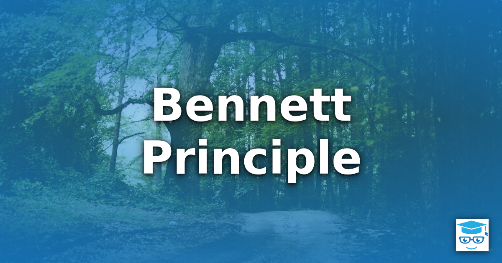

_"The value you receive from an activity is proportional to the energy invested."_ — Bennett Principle

The Bennett Principle is a rule of thumb about learning and personal growth: you get out of an activity roughly what you put into it. Passively watching a conference talk, skimming documentation, or scrolling through a feed takes little energy, and it returns little lasting value. Building something with the ideas you encountered takes far more energy, and it returns far more. The principle matters to developers because so much of the job is learning, and the most comfortable way to learn is rarely the most effective.

## Table of Contents

- [Origin](#origin)
- [Creating Versus Consuming](#creating-versus-consuming)
- [Applying the Principle](#applying-the-principle)
- [Motivation: Purpose, Autonomy, and Mastery](#motivation-purpose-autonomy-and-mastery)
- [Limits of the Principle](#limits-of-the-principle)
- [See Also](#see-also)
- [References](#references)

## Origin

The principle is described in a post titled "The Bennett Principle" on the Eduk8me site, written by Ryan and published on May 15, 2021. The post frames the principle around how people learn, closing with advice on helping students and peers. The source does not give any background on the person the principle is named for, so this page does not attribute it to anyone in particular.

## Creating Versus Consuming

The central contrast is between creating content and consuming it. Consuming content is easy: it asks for attention, but not for decisions, and it is possible to feel productive while retaining almost nothing. Creating content asks much more of you. You have to decide what to say, find the gaps in your own understanding, and make the result work for someone else.

The Bennett Principle claims the value of creating exceeds the energy it takes. That is the interesting part of the claim. The relationship between energy and value is proportional, but creation sits on the better side of the exchange: the extra energy you invest buys more than it costs. The author applies this to physical making and to virtual creations alike, and observes that the effect shows up most in people who are already self-motivated.

## Applying the Principle

The source does not discuss software development, but applied to it, the principle suggests choosing the higher-energy version of a learning activity whenever you want the knowledge to stick.

| Lower energy (consuming) | Higher energy (creating) |
| ------------------------ | ------------------------ |
| Reading about a new framework | Building a small working app with it |
| Watching a talk on a design pattern | Refactoring a real class to use the pattern, then explaining why |
| Reading a teammate's pull request | Pairing with the author on the next change (see [Pair Programming](/practices/pair-programming/)) |
| Following a tutorial step by step | Rebuilding the tutorial's result from scratch, without looking |
| Reading about [Test-Driven Development](/practices/test-driven-development/) | Writing the next feature test-first |
| Attending a team knowledge-share | Writing up or presenting what you learned |

Writing up what you learn, whether as a blog post, an internal wiki page, or a short talk, is an especially good example. It takes more energy than reading, it exposes what you do not actually understand, and it leaves an artifact that helps other people. The same effort pays off twice.

A useful habit is to ask, after consuming something, "What can I make with this?" The answer does not need to be large. A single test, a small prototype, or a paragraph in your own words is often enough to shift the activity from passive to active.

## Motivation: Purpose, Autonomy, and Mastery

Investing more energy only works if you are willing to invest it. To explain how to build that willingness in others, the source draws on Daniel Pink's book _Drive_, which identifies three motivators:

- **Purpose**: the sense that the work matters.
- **Autonomy**: the freedom to choose what to work on and how.
- **Mastery**: the satisfaction of getting better at something.

The author's argument is that combining these motivators with the Bennett Principle is a strong way to help students and peers reach their potential. The same idea applies to development teams: people invest more energy in work they understand the reason for, have some say in, and can see themselves improving at. This is consistent with [Respect People](/principles/respect-people/) and [Amplify Learning](/principles/amplify-learning/), which treat motivated, learning-focused teams as a source of better software.

## Limits of the Principle

The Bennett Principle is a heuristic, not a formula. Keep a few caveats in mind:

- **Effort is not the same as value.** Energy spent on the wrong thing, or spent inefficiently, returns little. Spending a week on a hand-rolled framework to learn one concept is a poor trade when a short prototype would do, a trap related to [Keep It Simple](/principles/keep-it-simple/) and [YAGNI](/principles/yagni/).
- **Consuming still has a place.** You cannot create something from nothing. Reading, listening, and reviewing existing work supply the raw material that creation turns into understanding.
- **Energy is finite.** Investing heavily in everything leads to burnout. Spend high energy where the learning matters most, and accept [imperfection](/principles/tolerance-for-imperfection/) elsewhere.

## See Also

- [Amplify Learning](/principles/amplify-learning/)
- [Respect People](/principles/respect-people/)
- [Keep It Simple](/principles/keep-it-simple/)
- [Tolerance for Imperfection](/principles/tolerance-for-imperfection/)
- [Pair Programming](/practices/pair-programming/)
- [Test-Driven Development](/practices/test-driven-development/)

## References

Ryan, [The Bennett Principle](https://eduk8.me/the-bennett-principle/), Eduk8me, May 15, 2021

Daniel H. Pink, _Drive: The Surprising Truth About What Motivates Us_, Riverhead Books, 2009
