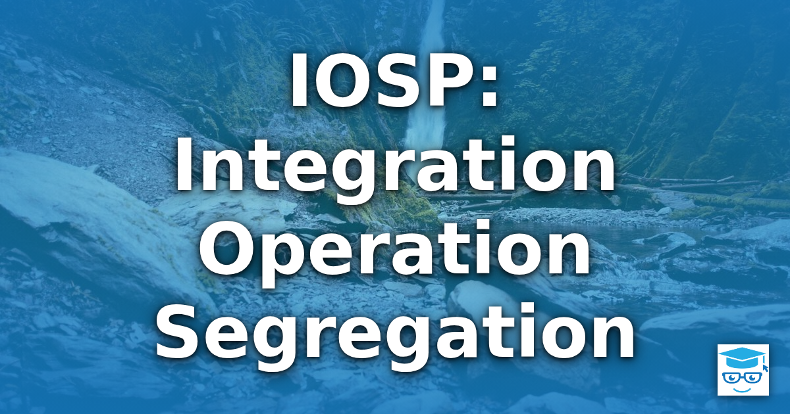
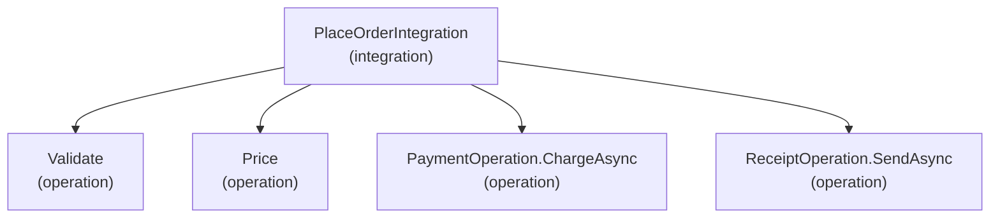

_"If you want to write radically object-oriented code, then operation and integration must be strictly separated."_ — Ralf Westphal

The Integration Operation Segregation Principle (IOSP) is a rule for deciding what a function is allowed to do. A function either **integrates** other functions, wiring them together into a larger behavior, or it **operates**, containing the logic that does real work. It never does both. Most code in the wild mixes the two: a method that decides what to do, does some of it inline, and calls helpers for the rest. IOSP asks you to pull those apart so that every function has one clear kind of job and can be understood, tested, and changed on its own terms.

## Table of Contents

- [Origin](#origin)
- [Integrations and Operations](#integrations-and-operations)
- [A C# Example](#a-c-example)
- [The Resulting Structure](#the-resulting-structure)
- [Benefits](#benefits)
- [Applying IOSP in Practice](#applying-iosp-in-practice)
- [Limits and Trade-offs](#limits-and-trade-offs)
- [Related Ideas](#related-ideas)
- [See Also](#see-also)
- [References](#references)

## Origin

Ralf Westphal proposes IOSP as the second principle of what he calls Radical Object-Orientation. In his article "Radical Object-Orientation #06: Deriving the Integration Operation Segregation Principle (IOSP)," published March 1, 2024, he builds on Alan Kay's biological analogy for objects. Cells (objects) communicate through messages, but something has to arrange the cells so those messages reach the right place. Westphal calls the objects that operate on messages _operations_, calls the act of combining them into a new whole _integration_, and says that integration is "categorically different from operation."

Westphal says IOSP is a consistent application of the [Single Responsibility Principle](/principles/single-responsibility-principle/): doing the work and arranging who does the work are two separate responsibilities.

## Integrations and Operations

IOSP sorts every function into exactly one of two categories.

| Aspect                           | Integration                                        | Operation                                              |
| -------------------------------- | -------------------------------------------------- | ------------------------------------------------------ |
| Purpose                          | Compose other functions into a larger behavior     | Perform a single piece of logic                        |
| Calls your other functions       | Yes, that is all it does                           | No                                                     |
| Contains logic                   | No branching, looping, or computation of its own   | Yes: expressions, conditionals, loops, transformations |
| Uses platform APIs or ports      | No, it leaves that to operations                   | Yes, such as the BCL, a database driver, or HTTP       |
| Typical test style               | Few tests, checking that the parts are wired right | Many fast tests, checking behavior and edge cases      |

An **integration** reads like a table of contents. It names its collaborators and passes data from one to the next, but it makes no decisions of its own and does not use platform APIs or external resources directly. An **operation** is a leaf: it does its work using language constructs, platform APIs, and external resources such as a database, a payment gateway, or an email service, and it does not reach back into your own application logic to call another function you wrote. An interface that stands for an outside system, such as `IPaymentGateway`, counts as that external resource, not as one of your own functions. Constructing a return value or simply passing data along is not considered logic.

The strictness of the "no logic" rule for integrations varies between presentations of the idea. The core of the principle is that the integration contains no business logic. Some practitioners tolerate trivial sequencing constructs, while stricter readings forbid any `if`, loop, or arithmetic. Whichever line you draw, draw it consistently across the codebase.

## A C# Example

Consider a typical method that validates an order, prices it, charges the customer, and sends a receipt. It calls helper methods, but it also contains logic of its own:

```csharp
public class OrderService
{
    private readonly IPaymentGateway _payments;
    private readonly IEmailSender _email;

    public OrderService(IPaymentGateway payments, IEmailSender email)
    {
        _payments = payments;
        _email = email;
    }

    // Mixed: it integrates other methods AND contains logic.
    public async Task<OrderResult> PlaceOrderAsync(Order order)
    {
        if (order.Lines.Count == 0)
        {
            return OrderResult.Failure("An order must contain at least one line.");
        }

        decimal subtotal = 0m;
        foreach (var line in order.Lines)
        {
            subtotal += line.UnitPrice * line.Quantity;
        }

        // Business rule buried among the plumbing.
        decimal discount = subtotal > 100m ? subtotal * 0.10m : 0m;
        decimal total = subtotal - discount;

        var charge = await _payments.ChargeAsync(order.CustomerId, total);
        if (!charge.Succeeded)
        {
            return OrderResult.Failure(charge.Error ?? "Payment failed.");
        }

        await SendReceiptAsync(order, total); // calls another method in this codebase

        return OrderResult.Success(total);
    }

    private Task SendReceiptAsync(Order order, decimal total) =>
        _email.SendAsync(order.CustomerEmail, "Your receipt", $"Total charged: {total:C}");
}
```

To test the discount rule, you need a payment gateway and an email sender, or fakes for both. To understand the flow, you have to read past the arithmetic. This method is both an integration and an operation, so it violates IOSP.

Applying IOSP splits it into operations that hold the logic and an integration that only wires them together. To preserve the original behavior, including the early returns, the operations return a `Result<T>`. The short-circuiting on failure lives in the `Result<T>` type's `Then` methods, so the integration needs no `if` statements of its own.

```csharp
// Infrastructure for the example: a minimal Result type. The "stop on failure"
// decision lives here, not in the integration that uses it.
public record Result<T>(T? Value, string? Error)
{
    public bool IsSuccess => Error is null;

    public static Result<T> Ok(T value) => new(value, null);
    public static Result<T> Fail(string error) => new(default, error);

    public TOut Match<TOut>(Func<T, TOut> onSuccess, Func<string, TOut> onFailure) =>
        IsSuccess ? onSuccess(Value!) : onFailure(Error!);
}

public static class ResultExtensions
{
    // Runs the next step only if the previous one succeeded.
    public static async Task<Result<TNext>> Then<T, TNext>(
        this Task<Result<T>> previous, Func<T, Result<TNext>> next)
    {
        var result = await previous;
        return result.IsSuccess ? next(result.Value!) : Result<TNext>.Fail(result.Error!);
    }

    public static async Task<Result<TNext>> ThenAsync<T, TNext>(
        this Task<Result<T>> previous, Func<T, Task<Result<TNext>>> next)
    {
        var result = await previous;
        return result.IsSuccess ? await next(result.Value!) : Result<TNext>.Fail(result.Error!);
    }
}

public record PricedOrder(Order Order, decimal Total);
```

The operations contain all of the decisions and calculations:

```csharp
// Pure operations: logic only, no calls to other functions in this codebase.
public static class OrderOperations
{
    public static Result<Order> Validate(Order order) =>
        order.Lines.Count > 0
            ? Result<Order>.Ok(order)
            : Result<Order>.Fail("An order must contain at least one line.");

    public static Result<PricedOrder> Price(Order order)
    {
        var subtotal = order.Lines.Sum(line => line.UnitPrice * line.Quantity);
        var total = subtotal > 100m ? subtotal - (subtotal * 0.10m) : subtotal;
        return Result<PricedOrder>.Ok(new PricedOrder(order, total));
    }
}

// Operations that reach outside the application. IPaymentGateway and IEmailSender are
// ports to external resources, like a database driver or an HTTP client, so using them
// does not count as calling another function in your own logic.
public class PaymentOperation
{
    private readonly IPaymentGateway _payments;

    public PaymentOperation(IPaymentGateway payments) => _payments = payments;

    public async Task<Result<PricedOrder>> ChargeAsync(PricedOrder priced)
    {
        var charge = await _payments.ChargeAsync(priced.Order.CustomerId, priced.Total);
        return charge.Succeeded
            ? Result<PricedOrder>.Ok(priced)
            : Result<PricedOrder>.Fail(charge.Error ?? "Payment failed.");
    }
}

public class ReceiptOperation
{
    private readonly IEmailSender _email;

    public ReceiptOperation(IEmailSender email) => _email = email;

    public async Task<Result<PricedOrder>> SendAsync(PricedOrder priced)
    {
        await _email.SendAsync(
            priced.Order.CustomerEmail, "Your receipt", $"Total charged: {priced.Total:C}");
        return Result<PricedOrder>.Ok(priced);
    }
}
```

The integration now reads as a description of the workflow and nothing more:

```csharp
public class PlaceOrderIntegration
{
    private readonly PaymentOperation _payment;
    private readonly ReceiptOperation _receipt;

    public PlaceOrderIntegration(PaymentOperation payment, ReceiptOperation receipt)
    {
        _payment = payment;
        _receipt = receipt;
    }

    // Pure integration: names the steps in order and passes data from one to the next.
    // It makes no decisions; Result<T> stops the chain at the first failure.
    public async Task<OrderResult> PlaceOrderAsync(Order order)
    {
        var result = await Task.FromResult(OrderOperations.Validate(order))
            .Then(OrderOperations.Price)
            .ThenAsync(_payment.ChargeAsync)
            .ThenAsync(_receipt.SendAsync);

        return result.Match(
            priced => OrderResult.Success(priced.Total),
            error => OrderResult.Failure(error));
    }
}
```

This version behaves like the original. An empty order returns the same failure without charging anyone. A declined payment returns the payment error and sends no receipt. Only a successful charge leads to the receipt and a `Success` result.

Notice what changed. The discount rule now lives in a small function that you can test with plain inputs and outputs, and the validation rule is just as easy to test. The integration shows the whole workflow in a handful of lines.

The early returns did not disappear; the principle moved them. Under a strict reading of IOSP, the decision to stop after a failure is logic, so it cannot live in the integration. Here it lives in `Result<T>`. You could instead have operations throw exceptions and let a caller higher in the hierarchy handle them, or make the branching its own operation. Which you pick is a design decision. The principle tells you where the decision must live, not what it must be.

Two things in the integration are not considered logic. Passing the output of one step to the next is plain data flow, and so is building the final return value, as `OrderResult.Success(priced.Total)` does. Neither makes a decision about the business domain.

## The Resulting Structure

Because integrations only call other functions and operations never do, the call graph has a clear shape. Integrations form the branches and operations form the leaves. An integration may call operations or other integrations, which lets you build up larger behaviors from smaller ones without breaking the rule.



This diagram matches the example above. `PlaceOrderIntegration` is the integration: it composes other functions and contains no logic of its own. The other four nodes are operations, the leaves that perform the work. No operation calls another function in your codebase, and the integration computes nothing. Integrations can also be nested: a larger integration can compose smaller ones, and an operation can never sit above an integration in the tree. Westphal likens an integration to a biological cell whose organelles are the objects it integrates, and says this is why Radical Object-Orientation scales.

## Benefits

Following IOSP tends to produce several practical improvements:

- **Readability.** An integration describes _what happens, in what order_, without the noise of how each step is done. An operation shows _how_ one step works without the noise of the surrounding workflow.
- **Testability.** Operations have no dependencies on your other functions, so they can be tested in isolation with simple inputs and outputs, often without test doubles. Integrations are thin enough that a small number of tests, or a review of the wiring, covers them. This supports a healthy [unit test](/testing/unit-tests/) base.
- **Changeability.** Reordering steps, adding a step, or swapping an implementation changes the integration. Fixing a business rule changes an operation. Each kind of change touches a different kind of function, and the two rarely collide.
- **Fewer hidden dependencies.** Because operations don't call your other code, a function's dependencies are visible at the integration that composes it rather than buried several calls deep.
- **Smaller functions.** The principle pushes against the [Long Method](/code-smells/long-method/) smell, since mixed functions are the ones that grow without bound.

## Applying IOSP in Practice

You do not have to rewrite a codebase to benefit. A few habits move code in the right direction:

1. When you read a method, ask whether it is deciding things or delegating things. If it is doing both, it is a candidate for splitting.
2. Extract each cohesive chunk of logic into a function that calls nothing else of yours. Name it for what it computes or decides.
3. Reduce the original method until it only calls the extracted functions and passes their results along.
4. Keep side effects such as I/O at the edges. Operations that touch a database, file system, network, or an injected port to one of them are still operations, but isolating them keeps the logic-only operations pure and trivial to test.
5. Be consistent about how you treat the framework. An operation may call platform APIs such as `string.Join` or `Math.Max`, and external resources such as a payment gateway, since those are not your own functions. An integration does neither directly; it only composes. Calling a helper you wrote from inside an operation is what the principle forbids.

[Refactoring](/practices/refactoring/) toward IOSP is safest when existing behavior is already covered by tests, so you can extract operations in small steps and confirm nothing changed.

## Limits and Trade-offs

Like most principles, IOSP is a guide, not a law, and it has costs:

- **More functions and more indirection.** A small workflow becomes several tiny functions. For a method that is already short and clear, splitting it can reduce clarity. Consider the [Fairbairn Threshold](/principles/fairbairn-threshold/): a name has to earn its keep.
- **Strictness is a judgment call.** Deciding whether a simple null check or a guard clause counts as "logic" in an integration is a matter of team convention. The value comes from consistency.
- **Control flow has to live somewhere.** Real workflows branch and loop. IOSP doesn't remove that need; it forces you to put the branching into a named operation or into the data flowing between operations. This is a feature, but it takes practice.
- **Not every paradigm fits equally.** The principle maps most naturally to function-oriented and data-flow-oriented designs. In a heavily stateful object model, you may find the boundary between integration and operation harder to draw.

## Related Ideas

IOSP overlaps with several other well-known ideas, which is useful when you need to explain it to a team.

- [Single Responsibility Principle](/principles/single-responsibility-principle/). Westphal presents IOSP as an application of SRP: coordinating work and doing work are separate reasons for a function to change.
- [Separation of Concerns](/principles/separation-of-concerns/). IOSP separates the concern of composition from the concern of computation.
- Single Level of Abstraction Principle (SLAP). A function should operate at one level of abstraction. An integration works at the level of steps in a workflow; an operation works at the level of a single computation. Mixing them is a common way to violate SLAP.
- Functional core, imperative shell. Both ideas push logic into small, easily tested units and keep the coordinating code thin.
- [Mediator](/design-patterns/mediator-pattern/) and [Facade](/design-patterns/facade-pattern/) patterns. Both often serve as the integrating layer that composes other components, though neither requires that the integrator be free of logic.

## See Also

- [Single Responsibility Principle](/principles/single-responsibility-principle/)
- [Separation of Concerns](/principles/separation-of-concerns/)
- [Parse, Don't Validate](/principles/parse-dont-validate/)
- [Fairbairn Threshold](/principles/fairbairn-threshold/)
- [Long Method](/code-smells/long-method/)
- [Refactoring](/practices/refactoring/)
- [Unit Tests](/testing/unit-tests/)
- [Dependency Injection](/practices/dependency-injection/)

## References

Ralf Westphal, [Radical Object-Orientation #06: Deriving the Integration Operation Segregation Principle (IOSP)](https://www.linkedin.com/pulse/radical-object-orientation-06-deriving-integration-iosp-ralf-westphal-fymbf), LinkedIn, March 1, 2024

[Radical Object-Orientation](https://radicalobjectorientation.substack.com/), Ralf Westphal's newsletter on the topic
